# md2card-skill

M2 的 48 个精确 standard / portrait 注册示例已完成独立助手源码、全 PNG、375/390px 手机图和原生 PDF 复核：35 套 v2、13 套 v3。见 [有限范围验收](docs/REFINEMENT_M2_ACCEPTANCE.md)。v1 / M1 v2 历史证据保持原样，不作为当前预览。

把 Markdown 与长文整理成清晰、有设计感的知识卡片。

这是一个可放入 Codex 或 Claude Code 技能目录的独立 Skill，也是一个可以直接运行的本地渲染工具。先做内容编排，再选原创主题，最后导出 HTML、PNG 或保留文本层的 PDF。

## 选择 48 套原创模板

按 [R01–R12 精修计划](docs/REFINEMENT_PLAN.md) 推进，不增加模板数量。[离线模板图库](docs/gallery/index.html) 现绑定 48 个当前已验收 PNG，覆盖 12 个家族、各 4 个独立构图。验收仅覆盖精确输入、standard / 3:4、manual 和本次 CI 字体环境，不保证任意输入都能放下。

八个指定画幅短例已完成 full PNG、375/390 和 native PDF 独立复核，并由独立证据注册表绑定；T04/T21 四组合为 aspect-v2，T05/T13/T24/T37 四组合为 aspect-v1。仅限精确输入、standard/manual，不扩张为 48×3 或所有内容适配。 见[画幅复核](docs/ASPECT_PR22_REVIEW.md)。T20图内微字仍仅作上下文，T48右栏短尾等既有限制保留。

下载完整仓库后打开 `docs/gallery/index.html`，GitHub 文件页本身不运行 HTML。图库只展示已绑定证据的真实输出；[当前本地候选复核](docs/GALLERY_PR22_UI_REVIEW.md)完成66项真实浏览器检查和29张截图逐图复核，覆盖筛选、file:// CSP、键盘、无脚本回退、手机重排和八个画幅证据链接。发布后仍须按精确输入变化重新验证，不能继承历史运行40074554707的0-current / 48-pending结果。原生菜单缩放与读屏仍未测试。使用方式见 [图库说明](docs/TEMPLATE_GALLERY.md)。

以下四张为当前 M2 的精确真实 PNG；历史图仍保留在历史验收记录。输入与 PNG/PDF 哈希见 M2 验收。

| T03 图文特写 | T19 系统模块架构 |
| --- | --- |
|  | 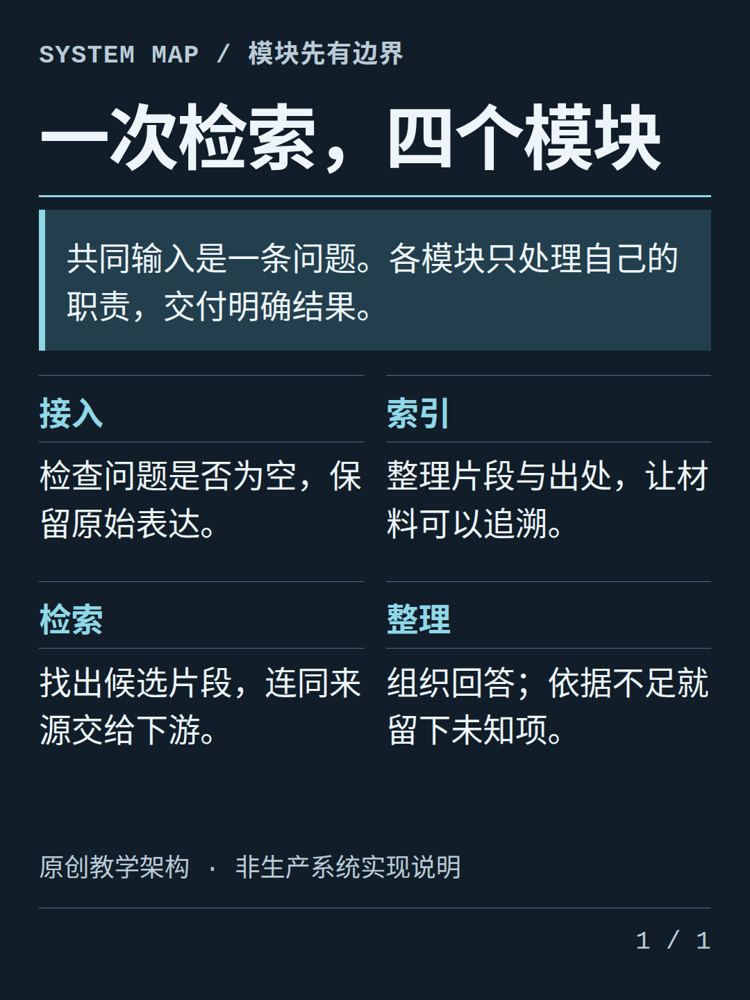 |
| T35 剪报拼贴资料卡 | T48 产品结构比较 |
| 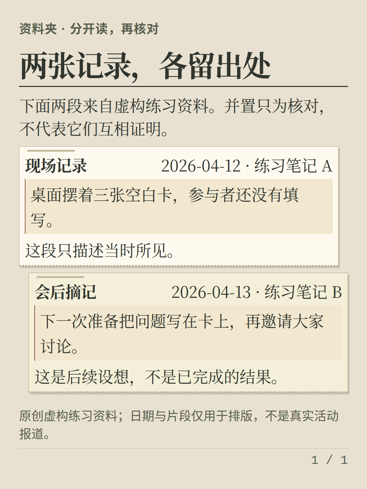 | 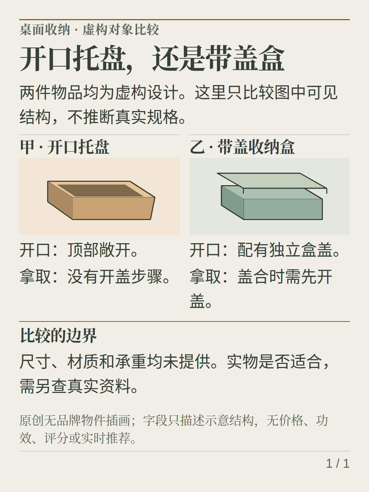 |

## 它能做什么

- 将笔记、教程、文章摘要整理为知识卡片，保留必要的出处、限定条件和不确定性。
- 提供 5 套原创主题与 8 种独立语义版式，主题、版式、品牌配置彼此分离。
- 默认用显式分页标记控制卡片数量；第三期增加可选的语义自动分页，不改写原文，也不偷偷缩小字体。
- 导出自包含 HTML、逐卡 PNG、原生文本 PDF，并检查内容溢出。
- 支持可信本地 PNG/JPEG/WebP 和 Logo；提供手机预览与联系表，无在线字体 CDN、账号、云同步、模型调用或自动发布。

## 真实渲染展示

以下展示及其验收记录来自第二期实现，不是第三期自动分页的验证证据。第三期代码、真实浏览器测试与视觉验收状态见 [分期开发计划](docs/DEVELOPMENT_PLAN.md)。

下图由本仓库命令实际导出，不是设计稿或外部产品截图。示例 PNG、PDF、手机预览和 manifest 由 CI 同时生成；复现命令见 [展示说明](docs/SHOWCASES.md)。

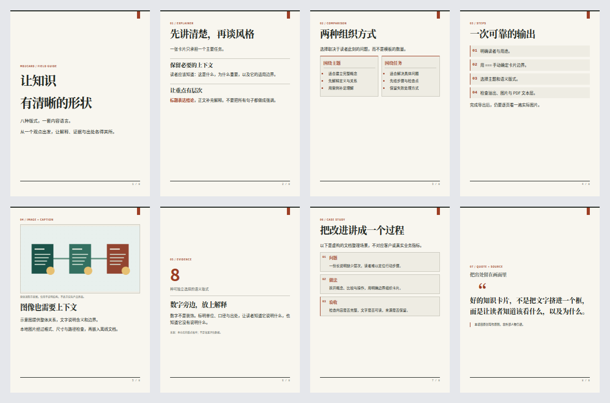

### AI / RAG 概念解释

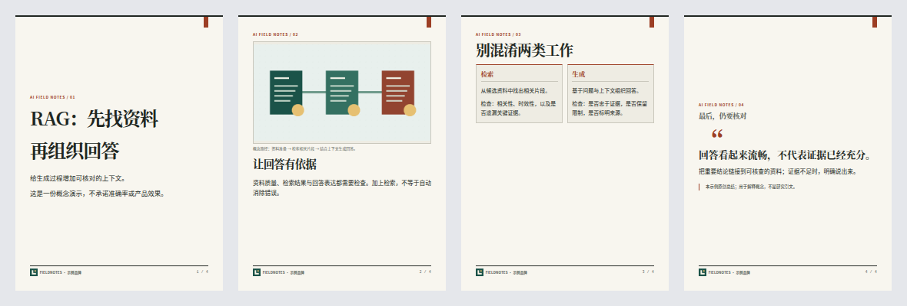

### 技术教程

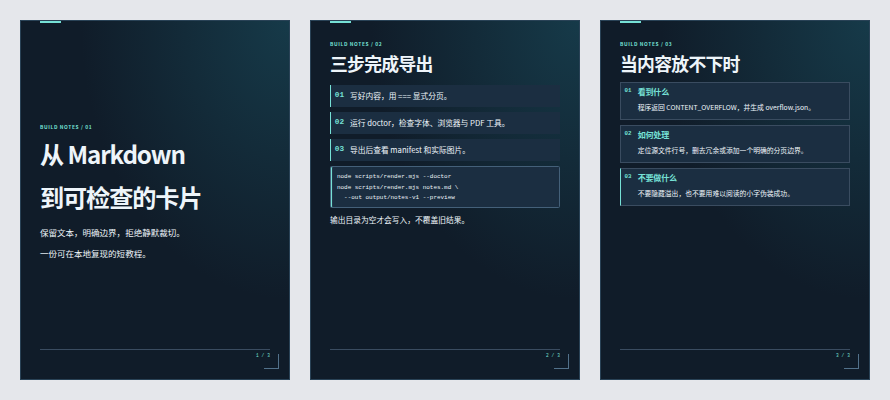

### 企业介绍（虚构示例）

FIELDNOTES 虚构品牌已统一，新的完整 PNG/PDF 已复核；本轮没有该旧例的新手机截图。历史展示不替代当前输入的证据，详见 [本轮验收](docs/TEMPLATE_UPGRADE_ACCEPTANCE.md)。

## 八种语义版式

默认 `manual` 模式支持下列八种版式；`auto` 模式仅支持 `explainer` 与 `steps`，具体限制见后文。

| layout | 用途 | 内容约定 |
| --- | --- | --- |
| `cover` | 封面 / 观点 | 大标题与少量说明 |
| `explainer` | 概念解释 | 默认版式，普通 Markdown 原样使用 |
| `comparison` | 双栏比较 | 前两个顶层二级标题分为两栏，后续内容保留在下方 |
| `steps` | 操作步骤 | 顶层有序列表显示序号与步骤块 |
| `image-caption` | 图片与图注 | `image`、`alt`、`caption` 搭配正文 |
| `statistic` | 数字 / 证据 | `metric`、`label` 与 `source`，不自动生成数字 |
| `case-study` | 案例过程 | 顶层二级标题组织问题、行动、结果等阶段 |
| `quote` | 引用 / 来源 | Markdown 引用块与 `source` 分开呈现 |

版式选择使用每张卡片第一条非空行中的可选 JSON 注释：

```markdown
<!-- card: {"layout":"statistic","metric":"8","label":"种语义版式","source":"本仓库的版式枚举"} -->
# 数字必须有解释

正文说明口径、含义和适用边界。
```

只接受明确字段，不允许任意 CSS 或 HTML。完整八版式示例见 [examples/layouts.md](examples/layouts.md)。

## 五种视觉方向

| 主题 | 风格 | 版式特点 |
| --- | --- | --- |
| `editorial` | 科学编辑 / 杂志感 | 暖白纸面、衬线标题、细双线页脚、砖红标记 |
| `minimal` | 克制极简 | 开放留白、侧边短线、轻量标题、青绿强调 |
| `midnight` | 深色技术 | 蓝黑底色、青色导引、结构边框、代码内嵌强调 |
| `notebook` | 学习笔记 | 淡横线、红色页边线、标注式标题、纸张质感 |
| `bold` | 大胆图形 | 粗边框、强标题线、反白小标题、方形引用块 |

主题说明和扩展约定见 [references/themes.md](references/themes.md)。

## 快速开始：直接渲染

需要 Node.js 20+、npm 和可启动的 Chromium。首次安装依赖需要网络，渲染过程不读取远程图片、字体或脚本。

```bash
git clone https://github.com/Activer007/md2card-skill.git
cd md2card-skill
npm ci
npx playwright install chromium
node scripts/render.mjs --doctor

node scripts/render.mjs examples/rag-guide.md \
  --theme editorial \
  --out output/rag-editorial \
  --format all \
  --footer "AI 知识卡"
```

如果已有 Chromium，可加 `--browser /absolute/path/to/chromium`。Linux 可能还需安装浏览器系统依赖；受限环境中不要为了运行而关闭安全限制。中文输出需要本地可用的中文字体。

成功后，目录中包含 `cards.html`、`card-001.png` 等逐卡图片、`cards.pdf` 和 `manifest.json`。PDF 通过浏览器原生打印生成，不是把图片拼成 PDF。

输出目录必须不存在或为空，不会覆盖已有文件。内容放不下时，程序返回非零状态并提供可定位的诊断，不会把裁切后的文件冒充成功结果。手动或最终全套布局溢出会写入 `overflow.json`；自动分页的不可拆分单元溢出会提供带源位置的错误。所有格式，包括仅 HTML，都需要 Chromium 做排版检查。

## 作为 Skill 使用

仓库根目录就是完整 Skill 文件夹。下列步骤是用户自行安装的方式，不代表创建仓库后已自动安装到任何账户或应用。

### Codex：项目级安装

在你希望使用该技能的项目根目录运行：

```bash
mkdir -p .agents/skills
git clone https://github.com/Activer007/md2card-skill.git \
  .agents/skills/md2card-skill
cd .agents/skills/md2card-skill
npm ci
npx playwright install chromium
```

随后在 Codex 中输入：

```text
使用 $md2card-skill，把这篇文章整理成面向初学者的知识卡片。
保留关键出处，采用 editorial 主题，导出 PNG 和 PDF。
```

个人级目录可使用 `~/.agents/skills/md2card-skill`。本地发现路径和更新行为以 [Codex 官方技能文档](https://developers.openai.com/codex/skills)为准；如果没有识别到新技能，重启会话后检查技能列表。

### Claude Code：项目级安装

在项目根目录，将同一个完整仓库放入 `.claude/skills/md2card-skill`：

```bash
mkdir -p .claude/skills
git clone https://github.com/Activer007/md2card-skill.git \
  .claude/skills/md2card-skill
cd .claude/skills/md2card-skill
npm ci
npx playwright install chromium
```

使用 `/md2card-skill`，或明确要求采用此技能。个人级目录为 `~/.claude/skills/md2card-skill`，具体加载方式见 [Claude Code 官方技能文档](https://code.claude.com/docs/en/skills)。这份目录安装说明面向本地会话，不承诺自动同步到云端产品。

也可以将下载或克隆后的整个文件夹复制到对应目录。不要只复制 `SKILL.md`，它会调用同目录中的脚本、样式和参考文档。已存在同名目录时先检查内容，不要直接覆盖。

## Markdown 分页

`--paginate manual` 是默认模式，保留现有行为。在代码围栏与缩进代码之外，用独占一行的 `===` 分隔卡片：

```markdown
# 第一张：一个核心观点

用短段落解释观点，并保留必要上下文。

===

# 第二张：一个具体例子

用例子说明，而不是重复上一张。
```

- 围栏代码块里的 `===` 是代码，不会分页。
- `---` 保留普通 Markdown 语义；前后空行时是横线，不是分页。
- 不使用 YAML frontmatter，标题等元信息通过命令参数传入。
- 支持标题、段落、列表、引用、链接、代码和表格。
- 原始 HTML 会转义；图片仅接受可信资源目录内经验证的本地 PNG/JPEG/WebP。
- 引用式链接定义可跨卡片使用；缩进代码首行的空格会保留。

完整原创示例：[RAG 入门四张卡片](examples/rag-guide.md)。解析边界示例：[代码中的分页符](examples/separator-demo.md)。

### 可选语义自动分页（第三期）

需要保留长文原样、但允许增加卡片数量时，可选择 `--paginate auto`。第三期已完成独立源码复核与真实浏览器验收：148 项测试全部通过，四套新案例共 24 张卡片；具体提交、视觉检查范围与剩余限制见 [分期验收记录](docs/DEVELOPMENT_PLAN.md)。默认仍为 `manual`，自动分页不是内容编辑。

```bash
node scripts/render.mjs long-explainer.md --out output/long-explainer-v1 \
  --paginate auto --theme editorial --format all
```

- 仅支持 `explainer` 和 `steps`，每个显式分段的卡片元数据仅允许 `layout`。其他版式报 `PAGINATION_UNSUPPORTED_LAYOUT`；`source`、`eyebrow` 等额外字段报 `PAGINATION_UNSUPPORTED_METADATA`，不会被忽略或悄悄删除。需要这些元数据时继续使用 `manual`。
- `===` 是锁定边界。自动分页只能在一个显式分段内部继续拆分，不跨边界合并内容。
- 保留原始 Markdown token、文字、顺序和来源。段落、代码块、引用块、图片以及含嵌套内容的顶层列表项不可拆开；有序列表续页保留起始编号。表格可以在行之间拆开，重复的表头会在来源记录中注明。
- 连续标题与后续内容单元组成一组，避免单独落在页尾。浏览器分别测量屏幕与打印布局，贪心地尝试放入当前卡片，放不下时将整组移至下一张。
- 单组放在空白卡片仍溢出时，以 `PAGINATION_ATOMIC_OVERFLOW` 和源位置失败，不裁切、不缩字、不调用模型，也不自动删改内容。可以调整画布、改用手动分页，或在你明确同意后修改原文。
- 分页最多处理 2,000 个语义单元、4,000 次候选探测、200 张卡片，并继续遵守资源、像素和时间预算。探测时预留 `200/200` 页脚；最终使用实际页数再次检查全套卡片的屏幕与打印布局。

完整拆分规则、错误码与可追溯记录见 [渲染契约](references/rendering.md)。自动分页是几何排版辅助，不是内容策划、事实核查或逐页视觉验收。

以下两张联系表来自第三期真实导出，未经裁切或修图，来源和 SHA-256 见 [展示记录](docs/SHOWCASES.md#phase-3-automatic-pagination)。

#### 列表跨页保留编号

[原始列表示例](examples/pagination-lists.md) 从 7 开始编号，自动生成 7 张卡片；顶层列表项及其嵌套内容保持完整。

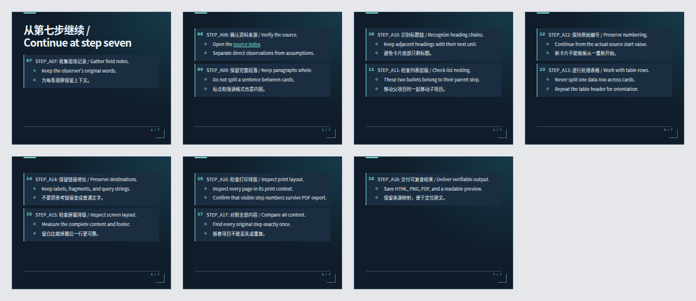

#### 表格按行分页并重复表头

[原始表格示例](examples/pagination-tables.md) 自动生成 6 张卡片。续页重复原始表头，并在 manifest 中记录表头来源；不会拆开单行或丢弃内容。

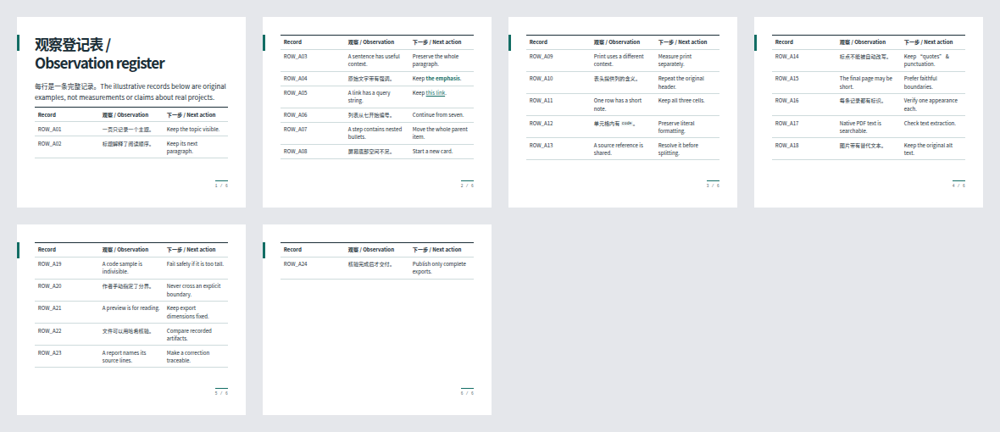

其他可复现示例：[长段落](examples/pagination-paragraphs.md)、[引用及显式边界](examples/pagination-references.md)、[超大代码块的预期失败](examples/pagination-atomic-error.md)。这组验收使用 1080×900 画布；更换字体或尺寸后页数可能变化。只支持 `explainer` / `steps` 及 `layout` 元数据，不自动改写、删减或缩字。

## 本地图片与品牌

默认资源边界为输入 Markdown 所在目录，也可以显式指定 `--asset-root DIR`。图片引用相对此目录解析，而不是相对品牌 JSON 所在目录。

```markdown

```

```bash
node scripts/render.mjs examples/showcase-ai.md \
  --out output/ai-v1 --brand examples/brand.json \
  --preview --contact-sheet --strict
```

品牌 JSON 只接受 `name`、十六进制 `accent`、本地 `logo`。`--preview` 生成无需脚本的手机阅读页面；`--contact-sheet` 生成整套卡片缩略联系表。预览缩放不改变导出画布尺寸。

不接受 SVG、GIF、远程地址、`file:` / `data:` 输入、绝对路径或越界软链接。文件扩展名、真实 MIME、文件体积与像素尺寸均检查，浏览器还会实际解码图片。完整资源限制见 [渲染契约](references/rendering.md)。

## 常用参数

```bash
# 深色主题，PNG 与 PDF
node scripts/render.mjs cards.md --out output/dark-v1 \
  --theme midnight --format png,pdf

# 方形卡片；需要按更短画布重新组织内容
node scripts/render.mjs short-cards.md --out output/square-v1 \
  --size square --theme minimal --format png

# 自定义尺寸；scale 只改变 PNG 像素密度，不改变文字排版
node scripts/render.mjs cards.md --out output/custom-v1 \
  --width 1200 --height 1600 --scale 2 --format all

node scripts/render.mjs --help
```

默认 `portrait` 为 1080×1440；`square` 为 1080×1080；`slide` 为 1600×900。不同画幅容量不同，不保证同一份内容直接通用。宽屏卡片也不等于可编辑幻灯片。

完整参数、输出契约与故障处理见 [references/rendering.md](references/rendering.md)。

## 质量与边界

见 [分期开发计划](docs/DEVELOPMENT_PLAN.md) 与 [源码审查及定向回归记录](docs/CODE_REVIEW.md)。后者记录具体缺陷、最小复现、修复和剩余限制，不以 CI 通过代替代码审查。

第二期历史验收：代码提交 [`7df842d`](https://github.com/Activer007/md2card-skill/commit/7df842dca5ff5bba237a9e5118e7e30b7af954c1) 已完成独立源码复核；[CI](https://github.com/Activer007/md2card-skill/actions/runs/39964850729) 通过 93 项测试（0 跳过），实际验证 10 套、56 张卡片。README 的四张展示图来自该提交的真实导出并已单独复核；检查范围与图片哈希见上述记录。

Skill 会指导内容规划、主题选择、渲染和逐页检查。程序检查几何溢出；选择 `auto` 时按受支持的语义边界分页，但不会判断观点是否正确、改写原文或审核引用。第三期的本地测试、真实 CI 与视觉验收在上述记录中单独列明；本次视觉检查覆盖四套联系表和代表性原尺寸卡片，不是对所有字形的穷尽检查。

- 本地系统字体会影响换行。需要稳定输出时，固定操作系统、字体、依赖与浏览器版本。
- 导出后仍应检查每张图的中文字符、标题换行、表格、代码和页脚，并验证 PDF 文本层。
- 不提供账号、云同步、内置模型调用、PPTX、SVG、Mermaid、数学公式、动画或一键发布。
- 自动分页需显式开启，限于上述受支持的内容；不提供 AI 改写或内置模型。已有八种版式仍可使用默认手动分页。
- `--strict` 要求可验证的本地中文字体覆盖和 Poppler PDF 工具。字体覆盖检查不等于实际字形或逐页视觉验收。
- manifest 记录输入/样式/资源/产物 SHA-256、工具版本、屏幕/打印溢出结果和 PDF 检查状态；自动分页还记录模式、语义覆盖和各卡片来源。人工视觉检查始终单独标记。
- 本仓库不包含第三方字体，不获得字体、商标或外部内容的再分发权。

维护时可运行：

```bash
npm test
npm run test:integration
node scripts/validate-showcases.mjs
node scripts/validate-pagination.mjs
```

集成测试需要能运行 Chromium 的环境。不要把依赖或浏览器缺失造成的失败误报为渲染验证通过。

## 项目结构

```text
SKILL.md                 技能入口与工作流程
agents/openai.yaml       Codex 界面元信息
assets/themes.css        五套原创主题与设计 token
assets/layouts.css       通用排版与八种语义版式
scripts/                 Markdown 解析与本地导出
references/              内容风格、主题与渲染说明
examples/                原创示例与本地演示资源
docs/DEVELOPMENT_PLAN.md  分期任务、验收条件与验证状态
tests/                  解析与导出测试
```

## 灵感来源与许可

产品方向受到 [mdcard.cn](https://mdcard.cn/) 及 [agnostic-ap/md2card](https://github.com/agnostic-ap/md2card) 的启发：让 Markdown 更适合以卡片形式阅读和分享。

这是独立编写的原创实现，不是上述项目的 fork，也与其维护者或服务不存在隶属、授权或背书关系。没有复制其源代码、CSS、模板、品牌图形或文案；主题使用编辑设计、极简、深色技术、横线笔记与图形海报等通用设计语言重新创作。

本仓库原创代码、样式和文档采用 [MIT License](LICENSE)。依赖项、外部链接内容与用户输入各自保留原有许可和权利；本许可不覆盖它们。详见 [NOTICE](NOTICE)。

## 48 套原创成品模板

成品模板包含完整构图、字阶、图文组织、来源与适用边界。12 个家族涵盖编辑杂志、瑞士极简、包豪斯、新粗野、深色科技、数据商业、温暖手账、东方书卷、复古报刊、胶片摄影、糖果波普与自然生活；每家族 4 套，不只做封面，也覆盖正文、教程、引用、案例和证据。

当前 48 个 standard / 3:4 注册示例的精确验收范围见 [M2 记录](docs/REFINEMENT_M2_ACCEPTANCE.md)；[v1 记录](docs/TEMPLATE_UPGRADE_ACCEPTANCE.md) 保持历史范围。[M1 原始验收](docs/TEMPLATE_ACCEPTANCE.md) 仍独立保留。以下四张是 M1 的真实历史 PNG，不是全库的新联系表或概念设计图：

| T01 编辑专题 | T05 数字索引 |
| --- | --- |
|  | 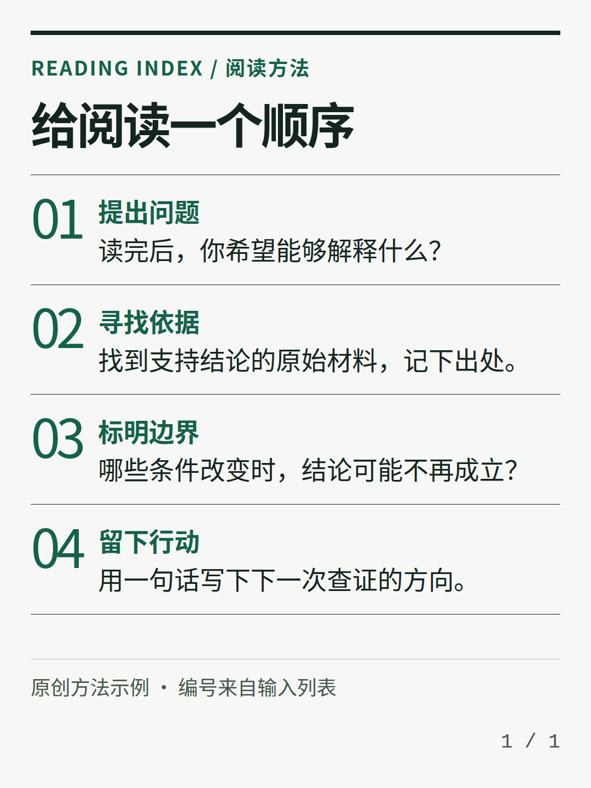 |
| T17 深色机制 | T25 阅读便签 |
| 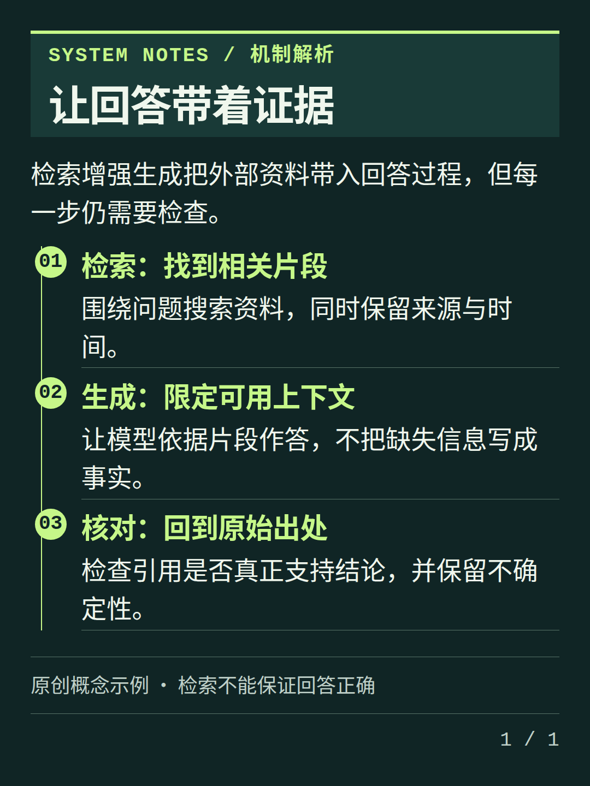 | 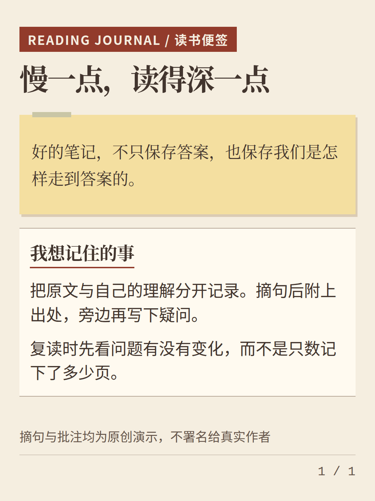 |

```bash
node scripts/render.mjs --list-templates
node scripts/render.mjs examples/templates/T01.md --out output/T01 --preview
node scripts/render.mjs my-note.md --template T25 --out output/my-note
```

也可在卡片第一行选择 `<!-- card: {"template":"T05","density":"standard"} -->`。模板使用 `manual`，保留原文与 `===`；现有 `auto` 仍仅支持 layout-only `explainer` / `steps`。`compact` / `standard` / `editorial` 只调间距，不缩小正文。mobile 阅读字阶在实际 351/366px 内卡上检查，旧主题不会被暗中改成新字号。

全部48套模板支持3:4；仅在 **6 个模板上增加 8 个额外画幅组合**：T04/T21各支持独立1:1与16:9，T05/T13仅增1:1，T24/T37仅增16:9，其余组合明确拒绝。当前13套v3/35套v2的精确standard/portrait示例已验收；八个指定画幅短例已完成 full PNG、375/390 和 native PDF 独立复核，并由独立证据注册表绑定；T04/T21 四组合为 aspect-v2，T05/T13/T24/T37 四组合为 aspect-v1。仅限精确输入、standard/manual，不扩张为 48×3 或所有内容适配。 T04/T21的v1 历史证据保持不变。原portrait输入在短画布仍可能溢出，不缩字、不删内容、不裁图。见[画幅与验证边界](docs/TEMPLATE_ASPECTS.md)。

`--list-templates` 列出用途、推荐长度、结构、图片需求、来源与完整输入。推荐字数只是选型参考；放不下时保留原文与诊断，换模板或由你明确选择编辑/增加分段，不自动删字、改写、缩字或裁切。

### 系列与有界排版改进

可选原创起点：[固定 5 张的证据阅读](examples/series/evidence-reading.md)、[直接从正文开始的 3 张均值教程](examples/series/mean-tutorial.md)。每张显式选择模板，不自动插封面、总结或 CTA；虚构数据、代码口径与品牌路径见 [系列说明](docs/SERIES_RECIPES.md)。

两组既有系列的当前 M2 精确产物已检查全部 8 张原图、16 张手机图及原生 PDF；18 案例压力矩阵中三个明确输出有独立视觉复核，其余技术控制不扩大为视觉验收。历史 v1 系列、压力和尾页记录保持原样。成功导出与预期拒绝分别记录，这些结果只覆盖明确输入，不扩张为任意内容保证。

[可选尾页平衡](docs/TAIL_BALANCING.md) 只在同一显式分区的末两页移动完整语义组，保留页数、编号、表头和来源；不强制填满所有尾页。[压力验证](docs/VISUAL_STRESS.md) 分开记录成功导出与预期拒绝，不声称覆盖任意内容。历史 v1 T34 装饰首字曾影响 PDF 抽取顺序，当前 v3 已移除该处理且精确原生 PDF 已复核，但不承诺带标签的可访问阅读顺序；图片内微字、旧 Notebook 字号和本轮状态见 [历史与当前状态](docs/VISUAL_BACKLOG_STATUS.md)。

实施顺序与独立审查门槛保留在 [九个里程碑](docs/VISUAL_MILESTONES.md)。新的真实结果与历史记录分开，不以 CI 全绿替代逐图检查。

### Optional footer modes

`--footer-mode legacy` remains the default. Choose `poster` to omit only a final single-card counter, `series` for padded sequence numbers, or `report` for a more explicit source/footer treatment. Supplied source, brand/logo, footer and AI/fact caveats remain intact in every mode; these are not fields to delete for visual cleanliness. Card metadata and automatic-pagination support do not expand. See [footer contract](docs/FOOTER_MODES.md). Fresh visual evidence is still pending.


### R09 / R10：按任务选型与真实同文测试

图库提供六条用途路线及短 / 中 / 中英混排三组同文，仍只有 48 套构图。run40079964688 的22案例已核验：17成功导出与5预期拒绝分别记录。三组绑定11个成功预览及T13指定中篇拒绝，精确PNG/手机图和新PDF页面的身份均核对；旧复核仅在像素逐字节相同时保留，短尾与窄栏限制继续显示。计划命令仅作源码检查，新内容仍需实际导出及独立复核。见[同文重新绑定](docs/COMPARISON_PR22_REVIEW.md)和[图库说明](docs/TEMPLATE_GALLERY.md)。

R11 四组作者系列共5/3/3/3张，包含有条件比较→条件表→可撤回试用及单图观察→双图对照→未知边界札记。run40079867143的14卡已逐张检查full PNG、375/390和原生PDF，新增C/D六张使用自己的实际产物；品牌、页序、原文、代码、图片和限制保留，不强制封面/CTA或自动改写。见[系列独立复核](docs/SERIES_PR21_REVIEW.md)。该结论仅属于记录的PR21来源与产物，不自动证明其他树或本地重新排版等价。
# 可选视觉诊断

渲染时增加 `--visual-audit` 可输出版本化 `visual-diagnostics.json`。报告使用实际 Chromium screen/print 文字行框与图片绘制区域，提示间距、分布、留白、截图面积、连续构图及图上文字人工检查。默认关闭，不修改内容、不改变安全溢出阻断，也不代表自动视觉验收。规则、模板例外、完整样例和已知误报见 [M3 视觉诊断说明](docs/visual-upgrade/M3_VISUAL_DIAGNOSTICS.md)。
