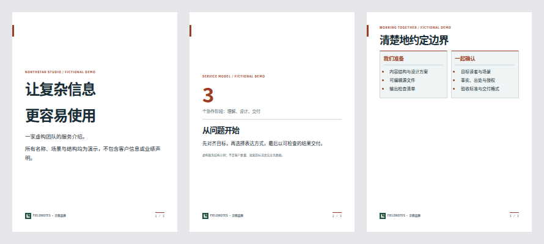

# md2card-skill

把 Markdown 与长文整理成清晰、有设计感的知识卡片。

这是一个可放入 Codex 或 Claude Code 技能目录的独立 Skill，也是一个可以直接运行的本地渲染工具。先做内容编排，再选原创主题，最后导出 HTML、PNG 或保留文本层的 PDF。

## 它能做什么

- 将笔记、教程、文章摘要整理为知识卡片，保留必要的出处、限定条件和不确定性。
- 提供 5 套原创主题与 8 种独立语义版式，主题、版式、品牌配置彼此分离。
- 用显式分页标记控制卡片数量，不强迫固定张数，也不会偷偷缩小字体。
- 导出自包含 HTML、逐卡 PNG、原生文本 PDF，并检查内容溢出。
- 支持可信本地 PNG/JPEG/WebP 和 Logo；提供手机预览与联系表，无在线字体 CDN、账号、云同步、模型调用或自动发布。

## 真实渲染展示

下图由本仓库命令实际导出，不是设计稿或外部产品截图。示例 PNG、PDF、手机预览和 manifest 由 CI 同时生成；复现命令见 [展示说明](docs/SHOWCASES.md)。


### AI / RAG 概念解释


### 技术教程


### 企业介绍（虚构示例）



## 八种语义版式

| layout | 用途 | 内容约定 |
| --- | --- | --- |
| `cover` | 封面 / 观点 | 大标题与少量说明 |
| `explainer` | 概念解释 | 默认版式，普通 Markdown 原样使用 |
| `comparison` | 双栏比较 | 前两个顶层二级标题分为两栏，后续内容保留在下方 |
| `steps` | 操作步骤 | 顶层有序列表显示序号与步骤块 |
| `image-caption` | 图片与图注 | `image`、`alt`、`caption` 搭配正文 |
| `statistic` | 数字 / 证据 | `metric`、`label` 与 `source`，不自动生成数字 |
| `case-study` | 案例过程 | 顶层二级标题组织问题、行动、结果等阶段 |
| `quote` | 引用 / 来源 | Markdown 引用块与 `source` 分开呈现 |

版式选择使用每张卡片第一条非空行中的可选 JSON 注释：

```markdown
<!-- card: {"layout":"statistic","metric":"8","label":"种语义版式","source":"本仓库的版式枚举"} -->
# 数字必须有解释

正文说明口径、含义和适用边界。
```

只接受明确字段，不允许任意 CSS 或 HTML。完整八版式示例见 [examples/layouts.md](examples/layouts.md)。

## 五种视觉方向

| 主题 | 风格 | 版式特点 |
| --- | --- | --- |
| `editorial` | 科学编辑 / 杂志感 | 暖白纸面、衬线标题、细双线页脚、砖红标记 |
| `minimal` | 克制极简 | 开放留白、侧边短线、轻量标题、青绿强调 |
| `midnight` | 深色技术 | 蓝黑底色、青色导引、结构边框、代码内嵌强调 |
| `notebook` | 学习笔记 | 淡横线、红色页边线、标注式标题、纸张质感 |
| `bold` | 大胆图形 | 粗边框、强标题线、反白小标题、方形引用块 |

主题说明和扩展约定见 [references/themes.md](references/themes.md)。

## 快速开始：直接渲染

需要 Node.js 20+、npm 和可启动的 Chromium。首次安装依赖需要网络，渲染过程不读取远程图片、字体或脚本。

```bash
git clone https://github.com/Activer007/md2card-skill.git
cd md2card-skill
npm ci
npx playwright install chromium
node scripts/render.mjs --doctor

node scripts/render.mjs examples/rag-guide.md \
  --theme editorial \
  --out output/rag-editorial \
  --format all \
  --footer "AI 知识卡"
```

如果已有 Chromium，可加 `--browser /absolute/path/to/chromium`。Linux 可能还需安装浏览器系统依赖；受限环境中不要为了运行而关闭安全限制。中文输出需要本地可用的中文字体。

成功后，目录中包含 `cards.html`、`card-001.png` 等逐卡图片、`cards.pdf` 和 `manifest.json`。PDF 通过浏览器原生打印生成，不是把图片拼成 PDF。

输出目录必须不存在或为空，不会覆盖已有文件。内容放不下时，程序返回非零状态并输出 `overflow.json`，不会把裁切后的文件冒充成功结果。所有格式，包括仅 HTML，都需要 Chromium 做排版检查。

## 作为 Skill 使用

仓库根目录就是完整 Skill 文件夹。下列步骤是用户自行安装的方式，不代表创建仓库后已自动安装到任何账户或应用。

### Codex：项目级安装

在你希望使用该技能的项目根目录运行：

```bash
mkdir -p .agents/skills
git clone https://github.com/Activer007/md2card-skill.git \
  .agents/skills/md2card-skill
cd .agents/skills/md2card-skill
npm ci
npx playwright install chromium
```

随后在 Codex 中输入：

```text
使用 $md2card-skill，把这篇文章整理成面向初学者的知识卡片。
保留关键出处，采用 editorial 主题，导出 PNG 和 PDF。
```

个人级目录可使用 `~/.agents/skills/md2card-skill`。本地发现路径和更新行为以 [Codex 官方技能文档](https://developers.openai.com/codex/skills)为准；如果没有识别到新技能，重启会话后检查技能列表。

### Claude Code：项目级安装

在项目根目录，将同一个完整仓库放入 `.claude/skills/md2card-skill`：

```bash
mkdir -p .claude/skills
git clone https://github.com/Activer007/md2card-skill.git \
  .claude/skills/md2card-skill
cd .claude/skills/md2card-skill
npm ci
npx playwright install chromium
```

使用 `/md2card-skill`，或明确要求采用此技能。个人级目录为 `~/.claude/skills/md2card-skill`，具体加载方式见 [Claude Code 官方技能文档](https://code.claude.com/docs/en/skills)。这份目录安装说明面向本地会话，不承诺自动同步到云端产品。

也可以将下载或克隆后的整个文件夹复制到对应目录。不要只复制 `SKILL.md`，它会调用同目录中的脚本、样式和参考文档。已存在同名目录时先检查内容，不要直接覆盖。

## Markdown 分页

在代码围栏之外，用独占一行的 `===` 分隔卡片：

```markdown
# 第一张：一个核心观点

用短段落解释观点，并保留必要上下文。

===

# 第二张：一个具体例子

用例子说明，而不是重复上一张。
```

- 围栏代码块里的 `===` 是代码，不会分页。
- `---` 保留普通 Markdown 语义；前后空行时是横线，不是分页。
- 不使用 YAML frontmatter，标题等元信息通过命令参数传入。
- 支持标题、段落、列表、引用、链接、代码和表格。
- 原始 HTML 会转义；图片仅接受可信资源目录内经验证的本地 PNG/JPEG/WebP。
- 引用式链接定义可跨卡片使用；缩进代码首行的空格会保留。

完整原创示例：[RAG 入门四张卡片](examples/rag-guide.md)。解析边界示例：[代码中的分页符](examples/separator-demo.md)。

## 本地图片与品牌

默认资源边界为输入 Markdown 所在目录，也可以显式指定 `--asset-root DIR`。图片引用相对此目录解析，而不是相对品牌 JSON 所在目录。

```markdown

```

```bash
node scripts/render.mjs examples/showcase-ai.md \
  --out output/ai-v1 --brand examples/brand.json \
  --preview --contact-sheet --strict
```

品牌 JSON 只接受 `name`、十六进制 `accent`、本地 `logo`。`--preview` 生成无需脚本的手机阅读页面；`--contact-sheet` 生成整套卡片缩略联系表。预览缩放不改变导出画布尺寸。

不接受 SVG、GIF、远程地址、`file:` / `data:` 输入、绝对路径或越界软链接。文件扩展名、真实 MIME、文件体积与像素尺寸均检查，浏览器还会实际解码图片。完整资源限制见 [渲染契约](references/rendering.md)。

## 常用参数

```bash
# 深色主题，PNG 与 PDF
node scripts/render.mjs cards.md --out output/dark-v1 \
  --theme midnight --format png,pdf

# 方形卡片；需要按更短画布重新组织内容
node scripts/render.mjs short-cards.md --out output/square-v1 \
  --size square --theme minimal --format png

# 自定义尺寸；scale 只改变 PNG 像素密度，不改变文字排版
node scripts/render.mjs cards.md --out output/custom-v1 \
  --width 1200 --height 1600 --scale 2 --format all

node scripts/render.mjs --help
```

默认 `portrait` 为 1080×1440；`square` 为 1080×1080；`slide` 为 1600×900。不同画幅容量不同，不保证同一份内容直接通用。宽屏卡片也不等于可编辑幻灯片。

完整参数、输出契约与故障处理见 [references/rendering.md](references/rendering.md)。

## 质量与边界

见 [分期开发计划](docs/DEVELOPMENT_PLAN.md) 与 [源码审查及定向回归记录](docs/CODE_REVIEW.md)。后者记录具体缺陷、最小复现、修复和剩余限制，不以 CI 通过代替代码审查。

Skill 会指导内容规划、主题选择、渲染和逐页检查。程序检查几何溢出，但不会判断观点是否正确，也不会自动替你改写、分页或审核引用。

- 本地系统字体会影响换行。需要稳定输出时，固定操作系统、字体、依赖与浏览器版本。
- 导出后仍应检查每张图的中文字符、标题换行、表格、代码和页脚，并验证 PDF 文本层。
- 不提供账号、云同步、内置模型调用、PPTX、SVG、Mermaid、数学公式、动画或一键发布。
- 不提供自动分页或 AI 改写；添加图片不会改变这些边界。
- `--strict` 要求可验证的本地中文字体覆盖和 Poppler PDF 工具。字体覆盖检查不等于实际字形或逐页视觉验收。
- manifest 记录输入/样式/资源/产物 SHA-256、工具版本、屏幕/打印溢出结果和 PDF 检查状态。人工视觉检查始终单独标记。
- 本仓库不包含第三方字体，不获得字体、商标或外部内容的再分发权。

维护时可运行：

```bash
npm test
npm run test:integration
node scripts/validate-showcases.mjs
```

集成测试需要能运行 Chromium 的环境。不要把依赖或浏览器缺失造成的失败误报为渲染验证通过。

## 项目结构

```text
SKILL.md                 技能入口与工作流程
agents/openai.yaml       Codex 界面元信息
assets/themes.css        五套原创主题与设计 token
assets/layouts.css       通用排版与八种语义版式
scripts/                 Markdown 解析与本地导出
references/              内容风格、主题与渲染说明
examples/                原创示例与本地演示资源
docs/DEVELOPMENT_PLAN.md  分期任务、验收条件与验证状态
tests/                  解析与导出测试
```

## 灵感来源与许可

产品方向受到 [mdcard.cn](https://mdcard.cn/) 及 [agnostic-ap/md2card](https://github.com/agnostic-ap/md2card) 的启发：让 Markdown 更适合以卡片形式阅读和分享。

这是独立编写的原创实现，不是上述项目的 fork，也与其维护者或服务不存在隶属、授权或背书关系。没有复制其源代码、CSS、模板、品牌图形或文案；主题使用编辑设计、极简、深色技术、横线笔记与图形海报等通用设计语言重新创作。

本仓库原创代码、样式和文档采用 [MIT License](LICENSE)。依赖项、外部链接内容与用户输入各自保留原有许可和权利；本许可不覆盖它们。详见 [NOTICE](NOTICE)。
