# md2card-skill

把文章、笔记或 Markdown 制作为适合阅读和分享的知识卡片。提供 **12 个设计家族、48 套原创成品模板**，可作为 Codex / Claude Code Skill 使用，也能在本地通过命令行导出 **PNG、HTML 和保留文字层的 PDF**。

[看全部模板](docs/TEMPLATE_CATALOG.md) · [使用 Skill](#使用-skill) · [命令行开始](#命令行快速开始) · [详细文档](docs/DOCUMENTATION.md)

## 先看模板效果

下面是 12 个设计家族各一张真实导出样例。点击图片看原图，进入详情获取 Markdown 输入、图片要求与支持画幅。

<!-- template-showcase:start -->
| 模板效果 | 模板效果 |
| --- | --- |
| **科学 / 编辑杂志 · T01**<br>[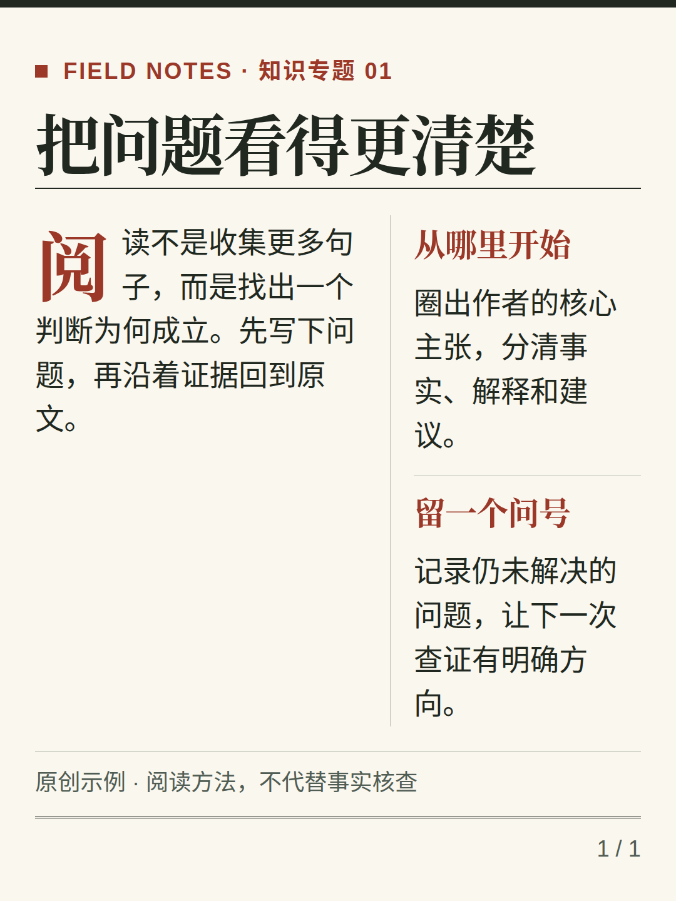](docs/images/refinement-m2-run-40074554707/T01.png)<br>专题开篇、概念导读<br>[模板详情与示例](docs/TEMPLATE_CATALOG.md#t01) | **瑞士极简 · T05**<br>[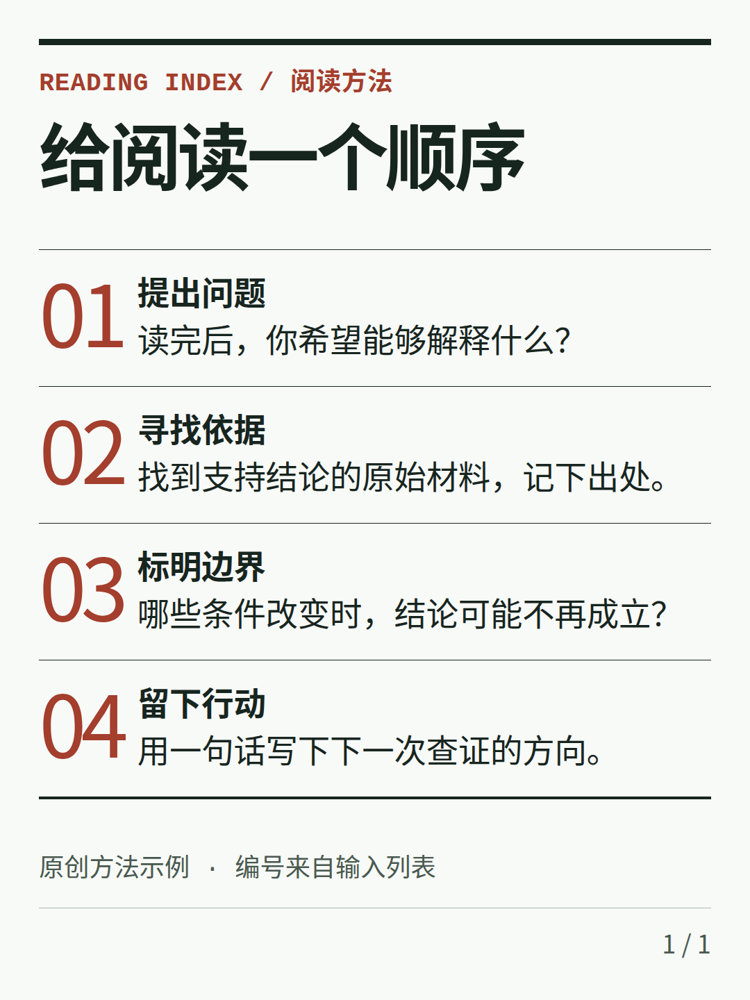](docs/images/refinement-m2-run-40074554707/T05.png)<br>方法清单、阅读导航<br>[模板详情与示例](docs/TEMPLATE_CATALOG.md#t05) |
| **包豪斯几何 · T09**<br>[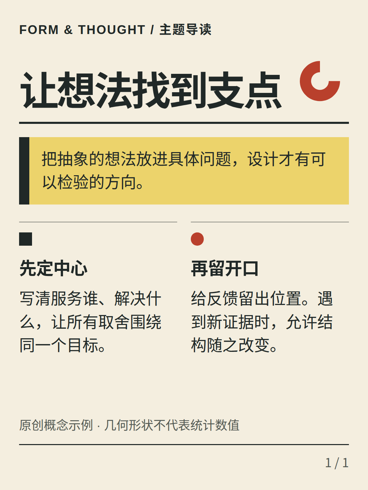](docs/images/refinement-m2-run-40074554707/T09.png)<br>概念专题开篇、工作坊主题与方法导读<br>[模板详情与示例](docs/TEMPLATE_CATALOG.md#t09) | **新粗野海报 · T13**<br>[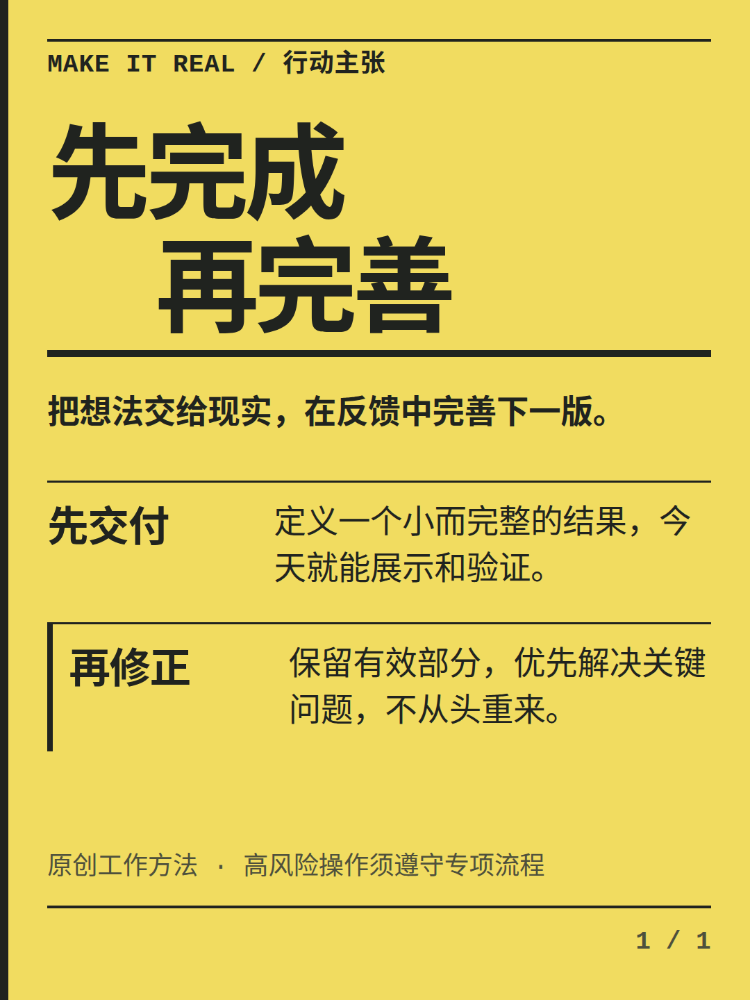](docs/images/refinement-m2-run-40074554707/T13.png)<br>行动主张、团队原则与明确的核心观点<br>[模板详情与示例](docs/TEMPLATE_CATALOG.md#t13) |
| **深色科技 · T19**<br>[](docs/images/refinement-m2-run-40074554707/T19.png)<br>解释系统的模块边界、输入与职责<br>[模板详情与示例](docs/TEMPLATE_CATALOG.md#t19) | **数据与商业 · T21**<br>[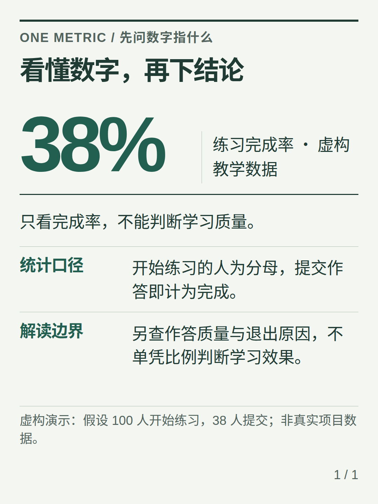](docs/images/refinement-m2-run-40074554707/T21.png)<br>突出一个指标，同时交代定义、范围与限制<br>[模板详情与示例](docs/TEMPLATE_CATALOG.md#t21) |
| **温暖手账 · T25**<br>[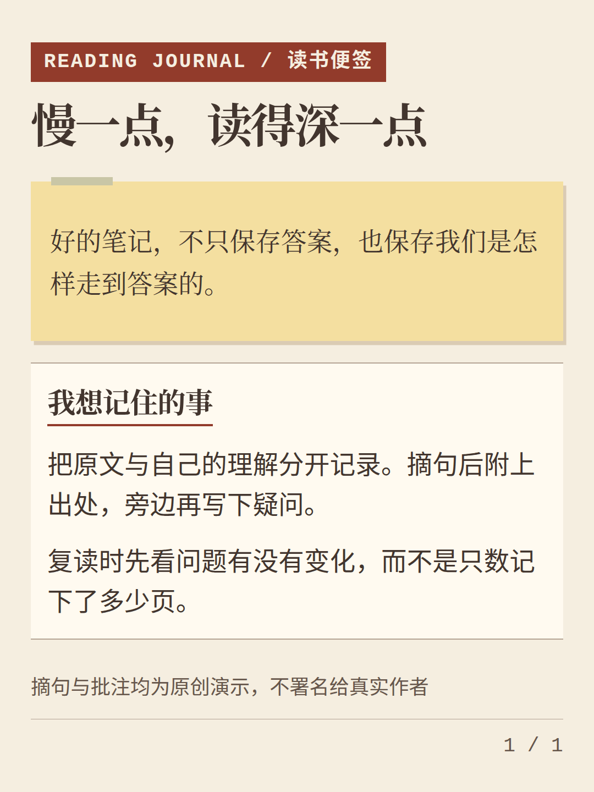](docs/images/refinement-m2-run-40074554707/T25.png)<br>阅读笔记、摘句与思考<br>[模板详情与示例](docs/TEMPLATE_CATALOG.md#t25) | **东方书卷 · T29**<br>[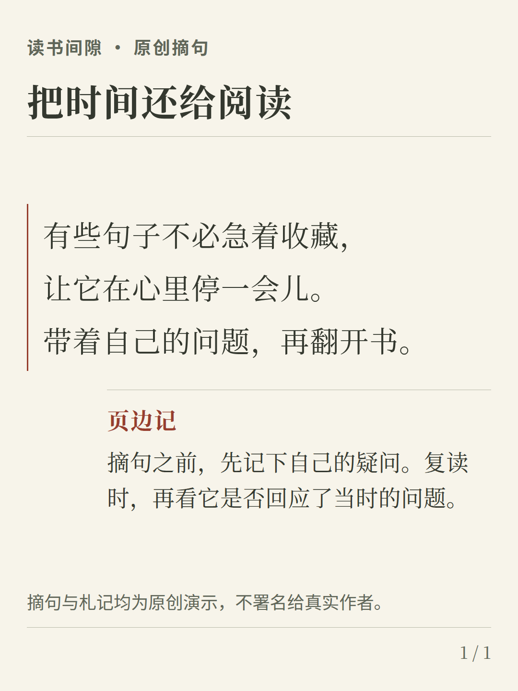](docs/images/refinement-m2-run-40074554707/T29.png)<br>短书摘、原创语句与独立阅读理解<br>[模板详情与示例](docs/TEMPLATE_CATALOG.md#t29) |
| **复古报刊 · T35**<br>[](docs/images/refinement-m2-run-40074554707/T35.png)<br>并列保存资料片段、记录日期和各自出处<br>[模板详情与示例](docs/TEMPLATE_CATALOG.md#t35) | **胶片摄影 · T37**<br>[](docs/images/refinement-m2-run-40074554707/T37.png)<br>影像记录、照片与短故事<br>[模板详情与示例](docs/TEMPLATE_CATALOG.md#t37) |
| **糖果波普 · T41**<br>[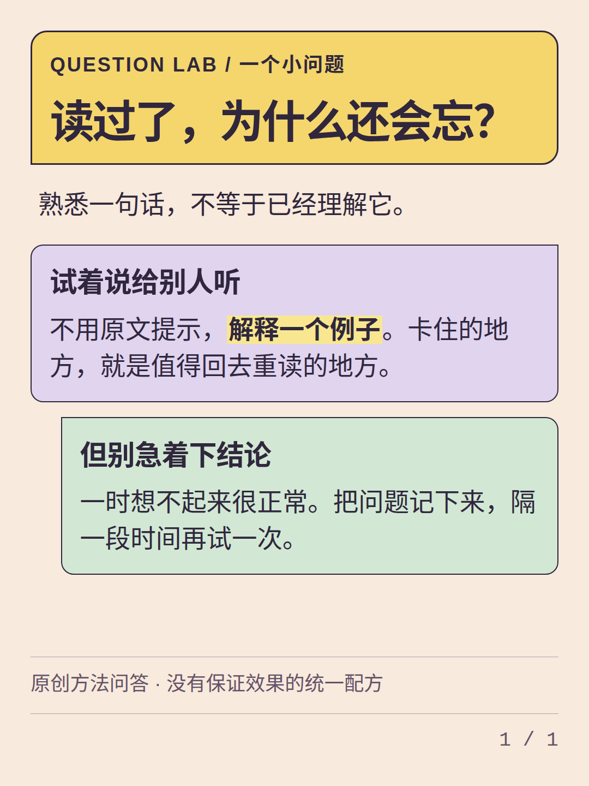](docs/images/refinement-m2-run-40074554707/T41.png)<br>问题解释、概念问答<br>[模板详情与示例](docs/TEMPLATE_CATALOG.md#t41) | **自然生活 · T48**<br>[](docs/images/refinement-m2-run-40074554707/T48.png)<br>让产品图、同一组对比字段与适用限制逐件对应<br>[模板详情与示例](docs/TEMPLATE_CATALOG.md#t48) |
<!-- template-showcase:end -->

**[浏览全部 48 套模板 →](docs/TEMPLATE_CATALOG.md)**　需要按用途筛选时，下载完整仓库后打开 [离线图库](docs/gallery/index.html)；GitHub 文件页不运行 HTML 图库。

以上均为已有样例的真实 PNG；部分图片与数据为明确披露的合成或虚构演示。替换内容、字体或画幅后仍需实际导出检查，不能把样例效果视为任意内容的排版保证。

## 使用 Skill

把完整仓库放入对应的技能目录，并安装依赖。安装一次后，直接向助手提供内容和要求。

新建卡片或请求推荐风格时，Skill 优先从 48 套成品模板中选型；已经指定模板、基础主题或要求原样渲染时，会沿用你的选择。只需要通用版式或受支持的自动分页时，再使用基础主题。详见[模板、主题与版式的区别](#模板主题与版式有什么区别)。

<details>
<summary>Codex：项目级安装</summary>

在目标项目根目录运行；同名目录已存在时先检查，不要覆盖：

```sh
git clone https://github.com/Activer007/md2card-skill.git .agents/skills/md2card-skill
cd .agents/skills/md2card-skill
npm ci
npx playwright install chromium
node scripts/render.mjs --doctor
```

在 Codex 中明确调用 `$md2card-skill`。个人级安装、中文字体及已有浏览器配置见 [Skill 使用指南](docs/SKILL_USAGE.md)。

</details>

<details>
<summary>Claude Code：项目级安装</summary>

```sh
git clone https://github.com/Activer007/md2card-skill.git .claude/skills/md2card-skill
cd .claude/skills/md2card-skill
npm ci
npx playwright install chromium
node scripts/render.mjs --doctor
```

在 Claude Code 中调用 `/md2card-skill`，或明确要求使用该技能。完整说明见 [Skill 使用指南](docs/SKILL_USAGE.md)。

</details>

### 从文章开始

```text
使用 md2card-skill，把下面这篇文章整理成适合手机阅读的知识卡片。
从 48 套模板中推荐三款适合内容的构图，给出真实样例和理由，再让我选择。
保留数字、来源和限定条件；正文使用“大”，导出 PNG 和 PDF。
```

### 已经选好模板

```text
使用 md2card-skill，按 T25 制作这份阅读笔记。
保留原文和已有分页，不添加总结或 CTA。先检查是否满足模板结构；
放不下时指出问题，不要自动删字、缩字或换模板。
```

### 制作公众号封面对

```text
使用 md2card-skill，为我提供的两份独立 Markdown 制作公众号封面对。
主封面 2100×900，分享封面 1080×1080，使用支持的 T01/T21 组合。
先让我确认两份标题、数字、单位和来源，再执行配对导出；只保存在本地。
```

通常交付可编辑 Markdown、PNG、HTML、原生 PDF，以及记录来源和检查结果的 manifest。具体输出以你的要求为准。[更多提示词、安装与排错](docs/SKILL_USAGE.md)。

如果希望沿用基础主题，也可以直接说：“使用 md2card-skill，按 minimal 主题和 explainer 版式原样渲染 cards.md，保留分页，不改用成品模板。”

## 按用途选择

| 想做什么 | 从哪里开始 |
| --- | --- |
| 知识解释、教程、清单、书摘 | [48 套效果目录](docs/TEMPLATE_CATALOG.md)，查看用途与结构条件 |
| 不确定选哪个模板 | [只读模板推荐](references/recommendations.md)，先看候选与理由，再实际渲染 |
| 产品界面介绍 | [T20 截图构图](docs/GALLERY_VISUAL_VARIANTS.md)，保留完整截图 |
| 照片配标题 | [T37 摄影封面](docs/GALLERY_VISUAL_VARIANTS.md)，需明确裁切许可和安全文字区 |
| 微信公众号主封面与分享封面 | [独立双封面](examples/wechat-covers/README.md)，两份作者确认的输入 |
| 多张连续卡片 | [系列示例](docs/SERIES_RECIPES.md)，保留作者分页与内容顺序 |

### 模板、主题与版式有什么区别？

| 类别 | 数量与作用 | 如何选择 |
| --- | --- | --- |
| 成品模板 `template` | 48 套、12 个设计家族；每套有完整构图、图文结构和独立样式 | [看效果和示例](docs/TEMPLATE_CATALOG.md)，通过 T01–T48 选择，仅支持手动分页 |
| 基础主题 `theme` | 5 种：`editorial` / `minimal` / `midnight` / `notebook` / `bold`；用于通用版式的视觉样式 | 明确指定主题，或需要受支持的自动分页时使用；[主题说明](references/themes.md) |
| 通用版式 `layout` | 8 种；组织封面、解释、对比、步骤、引用等内容结构 | 配合基础主题使用；[版式和参数](references/rendering.md) |

“五种基础主题”不代表只有五套模板。成品模板不继承基础主题 CSS，不能用 `--theme` 给模板换皮；12 个家族名也不是 `--theme` 参数值。不是所有模板都支持所有画幅，新增构图变体或画幅不会增加模板数量。

## 两种可选构图

| T20：产品截图为主 | T37：照片上的标题 |
| --- | --- |
| [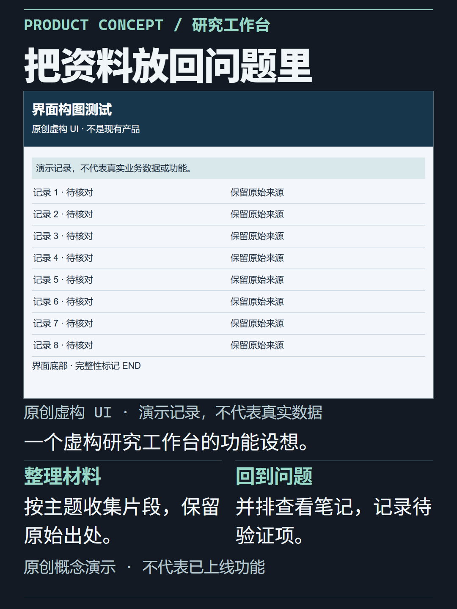](docs/images/gallery-variants/T20-stage.png) | [](docs/images/gallery-variants/T37-photo.png) |
| 原创虚构 UI 示例；不裁切截图，截图内微字不保证手机可读。 | AI 合成海岸示例；仅在作者授权裁切并检查主体后使用。 |

这两种是现有模板的可选构图，不增加模板数量。[字段、完整示例和适用条件](docs/GALLERY_VISUAL_VARIANTS.md)。

## 微信公众号双封面

宽图与方图分别排版，不把一张成品裁成两种尺寸。以下为既有 T01 独立画幅的本地原生导出，**不是微信公众号后台截图**。

| 21:9 主封面 · 2100×900 | 1:1 分享封面 · 1080×1080 |
| --- | --- |
| [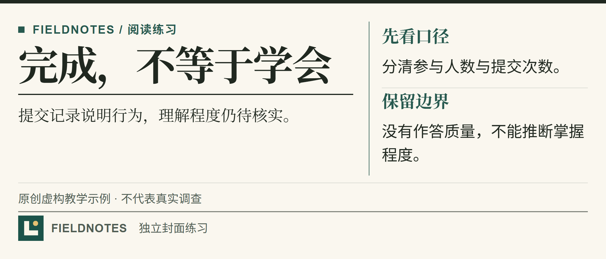](docs/images/m4-wechat-covers/T01-wide-native.png) | [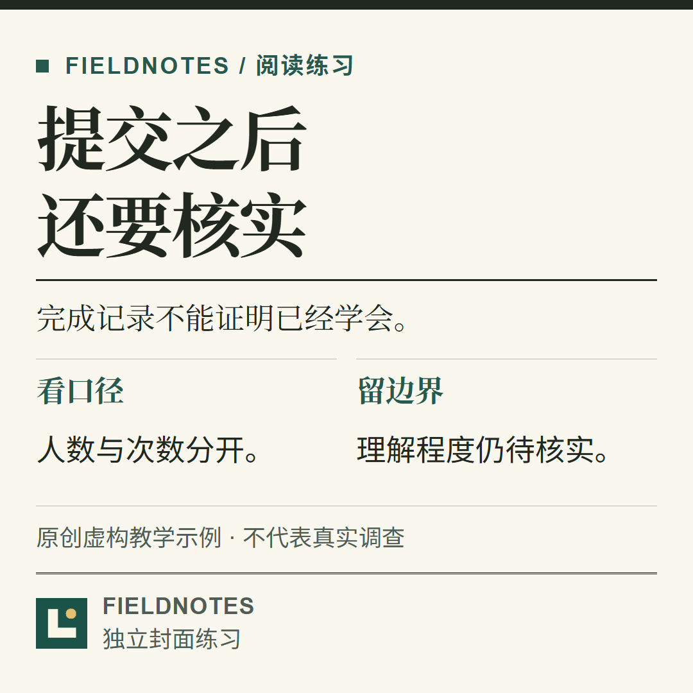](docs/images/m4-wechat-covers/T01-square-native.png) |

```sh
node scripts/render-cover-pair.mjs --wide wide.md --square square.md --author-confirmed --out output/pair --strict
```

两份独立文件均需显式选择 T01/T21、各一张卡片，并由作者确认内容。任一侧失败不会发布完整配对，不自动改标题、删来源或宣称语义等价。[可运行示例与说明](examples/wechat-covers/README.md)。平台实际裁切与展示仍须人工核对；新的发布前预检流程尚未交付。

## 常用调整

| 需求 | 用法与说明 |
| --- | --- |
| 正文更大或更小 | `--body-size` 选择 `small`、`medium`、`large`、`xlarge`；对应小、中、大、特大，默认中。也接受中文档位；标题、页脚和图片不随之缩放 |
| 品牌名、强调色与 Logo | `--brand examples/brand.json`；[本地图片与品牌](references/rendering.md) |
| 手机预览 | `--preview`，缩放展示原画布，不改变导出排版 |
| 海报或系列页脚 | `--footer-mode poster` / `series`；[页脚说明](docs/FOOTER_MODES.md) |
| 手动分页 | 单独一行 `===`；默认保留你的分页与原文 |
| 长文自动分页 | 可选 `--paginate auto`，仅支持受限通用版式；[支持范围](references/rendering.md) |
| 视觉问题提示 | `--visual-audit` 输出实测诊断；[规则与例外](docs/visual-upgrade/M3_VISUAL_DIAGNOSTICS.md) |

T37 默认构图会为低对比品牌色选择可读的文字前景，保留品牌装饰、Logo 与来源；[修复说明](docs/T37_DEFAULT_CONTRAST.md)。字号、间距与 PNG 像素密度是不同设置，不用缩字掩盖内容溢出。

## 命令行快速开始

需要 Node.js 20+、npm、可启动的 Chromium 和本地中文字体。从仓库根目录运行：

```sh
git clone https://github.com/Activer007/md2card-skill.git
cd md2card-skill
npm ci
npx playwright install chromium
node scripts/render.mjs --doctor
node scripts/render.mjs examples/templates/T01.md --out output/T01 --format all --preview
```

输出包括 `cards.html`、`card-001.png`、`cards.pdf`、`preview.html` 和 `manifest.json`。输出目录须不存在或为空。

```sh
# 对自己的文章先查看候选模板，不改写输入或自动选版
node scripts/recommend-templates.mjs article.md --format text

# 正文使用“大”；仍需通过实际溢出检查
node scripts/render.mjs examples/templates/T01.md --out output/T01-large --body-size 大 --preview

# 列出模板 / 查看完整参数
node scripts/render.mjs --list-templates
node scripts/render.mjs --help
```

放大字号后的示例可能因内容溢出而拒绝，这是有效检查结果。已有浏览器可用 `--browser` 指定路径；[环境准备](docs/SKILL_USAGE.md#环境准备)、[Markdown 与参数手册](references/rendering.md)。

## 使用边界与文档

- 保留原文、数字、来源和限定条件；内容放不下时明确报错，不自动删字或缩字。
- 图片使用可信目录内的本地 PNG/JPEG/WebP。摄影封面的裁切需要明确授权；不读取远程图片或字体。
- 导出会检查 screen/print 几何溢出；字体会影响换行，仍需查看实际成品。机器通过不等于人工视觉或真实平台验收。
- 不接入微信账号、不自动上传；不提供 PPTX、SVG、Mermaid 或数学公式排版。

[完整文档导航](docs/DOCUMENTATION.md) · [开发与本地质量检查](docs/LOCAL_QUALITY_GATE.md) · [样例与历史验证](docs/SHOWCASES.md)

原创代码、样式和文档采用 [MIT License](LICENSE)。素材与用户输入保留各自权利；独立实现及灵感来源见 [NOTICE](NOTICE)。
