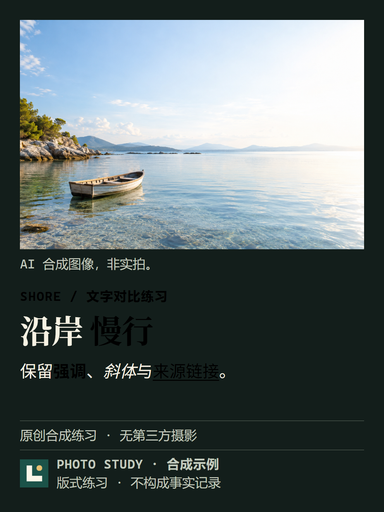
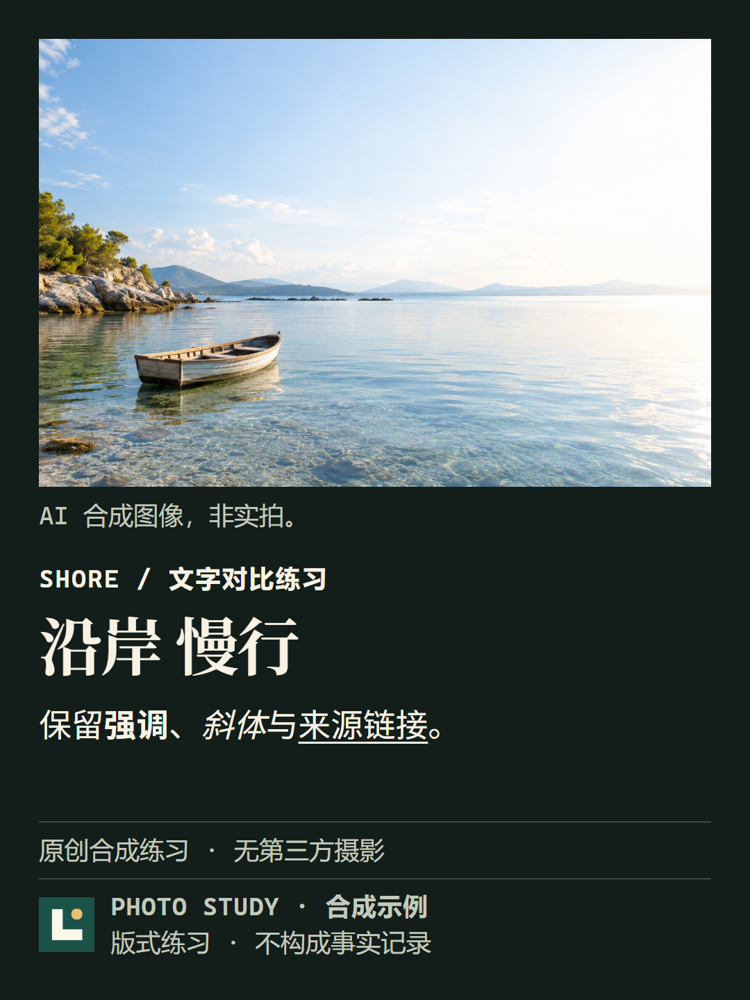
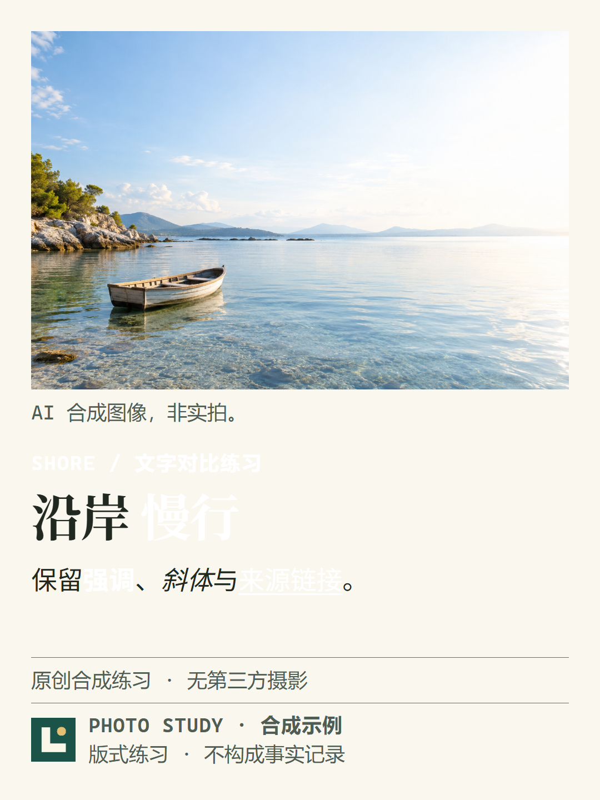
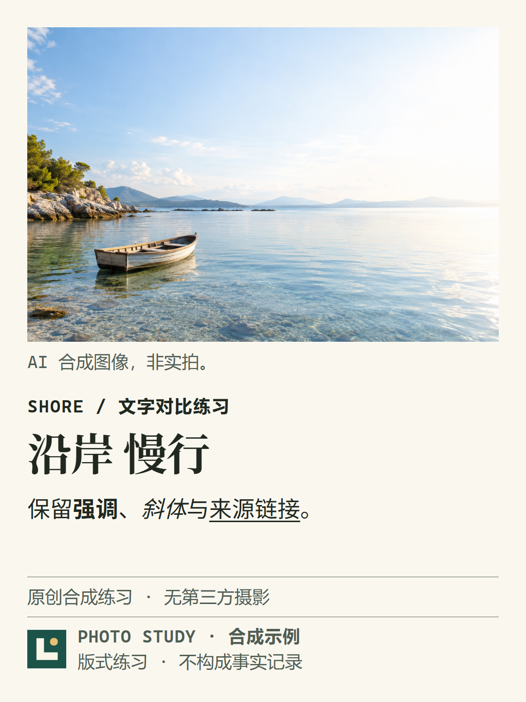

# T37 默认文字对比度修复

当 T37 默认构图使用黑色或较暗品牌色时，深底上的眉题、`strong`、链接和列表标记会难以辨认。本次仅在这些文字对品牌色的对比度不足时选择可读前景色；品牌名称、Logo、装饰线、图片、来源和正文不删改。`photo-cover` 有独立的摄影文字处理，不继承本次默认构图的结论。

## 规则与范围

`assets/templates.css` 的 T37 使用固定 `paper=#131e1b`、`panel=#0d1714`、`ink=#f7f2e3`；更换 `--theme` 不会使它变成浅底。`layouts.css` 中 `strong`、链接和列表标记继承 accent，T37 眉题也继承 accent；图注、来源、品牌名和页脚继承 muted，未发现需要改色。标题普通部分和正文使用 ink。

`scripts/document.mjs` 从可信模板 CSS 读取现有 paper/panel/ink。对显式品牌色计算其在两个纯色表面上的最低对比度：达到 4.5 则完全保留旧 HTML；不足则优先选已存在的 ink。若未来可信主题的 ink 不合格，按黑、白顺序寻找同时达到 4.5 的颜色；没有共同可读前景则报错，不偷偷接受。只接受现有品牌解析允许的 `#RGB` / `#RRGGBB`，不支持透明色或用户 CSS。

只在文档包含默认 T37 且品牌色不合格时追加 CSS，限定 `.template-T37:not([data-visual-variant="photo-cover"])` 的眉题、strong、a 与 `li::marker`。不改字号、布局、尺寸或原始 accent，不给其他模板注入颜色规则。未设置品牌色继续使用原来的浅金色。混合 T37 / photo-cover / T20 的实际 screen/print 检查确认隔离有效。

使用不舍入的 sRGB 相对亮度：通道归一化后以 0.04045 为分段点，线性亮度权重为 0.2126 / 0.7152 / 0.0722，对比度为 `(较亮亮度+0.05)/(较暗亮度+0.05)`。依据 [WCAG 对比度说明](https://www.w3.org/WAI/WCAG21/Understanding/contrast-minimum) 和 [G18](https://www.w3.org/WAI/WCAG21/Techniques/general/G18)。所有被测普通文字要求 ≥4.5；大字也用这一更严格目标，覆盖至少 3:1 的要求。摄影区域不纳入纯色计算。

浅底矩阵是明确的可信 CSS token 夹具：paper `#faf7ef`、panel `#eeeadd`、ink `#202820`、muted `#505d54`。它验证同一策略在浅底的行为，**不新增用户可选主题，也不声称当前 CLI 已提供浅底 T37**。

## 真实输出与受控差异

基线为 main `0ce7e161b20d2bad1dd789150dd16acd98b00c2f`。在 Windows、Chrome 156.0.8078.48、Node 24.16、Poppler 26.09.0 上采集 11 组新旧 HTML、screen/print PNG、375/390px 预览及原生 PDF；共 110 张用于比较的 PNG 和 22 份 PDF。报告逐元素保存 computed font family/size/weight、文字颜色、背景、对比度、bbox、图片和 Logo 哈希。PDF 使用真实文字层，`pdftotext -raw` 对照源 Markdown 可见片段，仅 NFC 和空白归一化。

| 案例 | 修复前最低比值 → 修复后 | screen / print 变化像素 | 375 / 390 变化像素 | PDF 栅格变化像素 |
| --- | --- | ---: | ---: | ---: |
| 无品牌、深底合格浅金、浅底合格绿 | 保留原色 | 0 / 0 | 0 / 0 | 0 |
| 深底纯黑 | 1.15 → 15.27 | 19830 / 19830 | 2831 / 2943 | 19364 |
| 深底暗色 #123 | 1.06 → 15.27 | 19830 / 19830 | 2831 / 2943 | 19364 |
| 浅底纯白 | 1.07 → 12.59 | 19830 / 19830 | 2831 / 2943 | 19364 |
| 浅底浅色 #f4edda | 1.03 → 12.59 | 19692 / 19692 | 2791 / 2906 | 19345 |
| 长标题、黑色品牌 | 1.15 → 15.27 | 13073 / 13073 | 1898 / 1975 | 12726 |
| 长图注、黑色品牌 | 1.15 → 15.27 | 17243 / 17243 | 2447 / 2536 | 16753 |
| photo-cover 对照、T20 对照 | 保留原色 | 0 / 0 | 0 / 0 | 0 |

比值列是 paper/panel 的最低值，不是摄影区域评分。黑色案例修复后正文/标题 15.27，未改的图注/来源/页脚为 10.15。长图注文字本身保持 muted；该案例的像素变化来自眉题、强调和链接。每组文字内容、图片/Logo 哈希和 bbox、新旧文字 bbox 均一致，无新增 screen/print 溢出。真实 `exportCards --strict --format all` 导出通过，长正文仍抛出 `CONTENT_OVERFLOW`。资源/时间预算、安全隔离和裁切授权未修改。

该环境的主标题 computed size 为 90.558px，正文 46.44px，眉题/图注/来源 36.18px；手机预览缩放整张画布。PDF 实际嵌入 Cascadia Mono、Microsoft YaHei、Noto Serif SC、Palatino Linotype、Noto Sans SC，完整子集名称与 Unicode 映射见 [pdffonts 输出](evidence/t37-default-contrast/pdf-fonts.txt)。这些不是跨平台字体一致性的保证。

| 黑色品牌：之前 | 黑色品牌：之后 |
| --- | --- |
|  |  |

| 浅底白色夹具：之前 | 浅底白色夹具：之后 |
| --- | --- |
|  |  |

兼容性按三类处理：

1. 未受影响默认案例：96 组既有默认/主题/画幅夹具乘无品牌/黑/浅金，排除两组有缺陷的 T37 黑色默认组合，286 组 HTML 逐字节一致；另 36 组既有 T20 stage / T37 photo 组合一致，共 322 组。原来的 96 组无品牌黄金哈希保留。
2. 问题案例：上述六组明确允许文字改色，保留变化像素数、最大通道差和差异 bbox；不宣称像素兼容。M2b 黑色品牌默认历史对照和图库四张历史成品保留，不覆盖旧黄金图。
3. 其他模板：47 套注册夹具在三种品牌条件下 HTML 均一致；T20 还完成真实五种栅格逐像素比较。没有重新渲染所有 47 套矩阵，不把 HTML 证据表述成全量截图复验。

图库兼容桥仅对已证实不变的历史夹具生效，并绑定新报告与渲染源码。`validate-photo-cover.mjs` 的黑色默认比较现只允许这段精确前景 CSS；任何其他 HTML 差异仍拒绝。8 组旧默认输入已检查，photo-cover 的几何、安全区、授权和硬溢出断言不变。

## 证据、失败记录与复核边界

- [完整结构化报告](evidence/t37-default-contrast/report.json)、[322 组兼容证明](visual-upgrade/t37-contrast-compatibility.json)、[混合卡片/面板/列表补充检查](evidence/t37-default-contrast/probe-report.json)。
- [完整原始成品归档](evidence/t37-default-contrast.tar.xz)：解压后打开 `index.html`，可查看全部新旧 screen/print、手机图、原生 PDF 栅格、PDF 与 HTML。报告中的 `archiveFiles` 逐文件记录 247 项原始运行文件的哈希；归档还带复现脚本与源码快照。
- [代理视觉检查清单](evidence/t37-default-contrast/agent-visual-review.json) 区分实际查看的 16 张图和自动比较的其他图。纯黑/浅白旧图缺字般的低对比现象已消除；长标题两行和长图注两行仍完整；photo-cover 白色局部底上的黑字清晰，小船主体未被遮挡。复杂图像判断只适用于这张合成图，不扩张为所有摄影图。
- run1 保留失败：T20 双栏被 `pdftotext -layout` 交错，导致片段误报；之前完成的 10 组仍有效。改用 `-raw` 严格逐片段检查。run2 的 T20 通过，但定向执行没有生成生产测试所需 `black.md`，因此失败；run3 补齐该输入并通过 T20、生产导出和溢出拒绝。三次期间渲染器与 CSS 哈希相同，只有验证脚本改动；最终报告是完整行的合并，不把 run1/run2 改成通过。
- 本次不验证任意自定义 CSS、透明/渐变表面、所有系统字体、其他浏览器、实际印刷设备、读屏或链接内容。代理查看不等于人类维护者签收；人类视觉检查保持 pending。`qa.visualReview` 不提升为自动验收。

## 本地复现

先安装项目锁定依赖；配置本机 Chromium、`pdftotext`、`pdfinfo`、`pdftoppm` 和项目所需字体。无需 GitHub Actions。

```powershell
git archive --format=tar --output validation/t37-baseline.tar 0ce7e161b20d2bad1dd789150dd16acd98b00c2f scripts assets package.json package-lock.json
New-Item -ItemType Directory -Path validation/t37-baseline
tar -xf validation/t37-baseline.tar -C validation/t37-baseline
npm run test:t37-contrast
npm run validate:t37-contrast -- --allow-browser --baseline-root validation/t37-baseline --out validation/t37-new --browser "C:/Program Files/Google/Chrome/Application/chrome.exe"
npm run quality:fast
npm run gallery:check
```

`--out` 必须是新的空目录，基线文件先按 Git 原始字节验证。可用 `--only T20-control` 定向复验；这种报告仅覆盖所选案例，不替代完整矩阵。生产导出和溢出检查仍执行。示例输入位于 `examples/t37-contrast/default.md`，品牌 JSON 沿用 `name/accent/logo` 合约。

参考仓库 `guizang-social-card-skill` 的编排说明已复核；本修复沿用本项目 token 与确定性颜色计算，没有复制参考仓库的 CSS 或素材。

## 提交前门禁记录

核心相关测试 30/30 通过，gallery:check 48/48 通过。首次完整受影响范围的本地 fast 门禁执行 656 项：655 通过、1 失败、0 跳过。唯一失败是既有推荐入口测试仍写死图库 59 张图，未计入 PR #33 已添加的 4 张变体证据；本次 renderGallery 生成的 HTML 和 main 一致。该运行保留为 [gate-initial](evidence/t37-default-contrast/gate-initial/report.md)，不改成绿色。测试断言的修正与增量门禁另行记录。
