# 48 套模板效果目录

[返回首页](../README.md) · [Skill 使用指南](SKILL_USAGE.md) · [下载后打开离线图库](gallery/index.html)

按家族浏览，点击图片查看原尺寸，点击 Markdown 查看可复现输入。此页可在 GitHub 直接阅读；离线图库需下载完整仓库后打开。

预览是已绑定的真实 1080×1440、标准间距、默认字号样例，不保证换成你的内容仍能放下。画幅列表表示已注册的支持范围，不表示竖图能直接裁成其他比例。额外画幅使用独立示例，见[画幅说明](TEMPLATE_ASPECTS.md)与[公众号封面](visual-upgrade/M4_WECHAT_COVERS.md)。素材包含明确披露的合成图及虚构演示，见[素材说明](../examples/templates/assets/README.md)。

- [科学 / 编辑杂志 · T01 / T02 / T03 / T04](#family-editorial)
- [瑞士极简 · T05 / T06 / T07 / T08](#family-swiss)
- [包豪斯几何 · T09 / T10 / T11 / T12](#family-bauhaus)
- [新粗野海报 · T13 / T14 / T15 / T16](#family-brutalist)
- [深色科技 · T17 / T18 / T19 / T20](#family-technology)
- [数据与商业 · T21 / T22 / T23 / T24](#family-business)
- [温暖手账 · T25 / T26 / T27 / T28](#family-journal)
- [东方书卷 · T29 / T30 / T31 / T32](#family-eastern)
- [复古报刊 · T33 / T34 / T35 / T36](#family-newspaper)
- [胶片摄影 · T37 / T38 / T39 / T40](#family-film)
- [糖果波普 · T41 / T42 / T43 / T44](#family-pop)
- [自然生活 · T45 / T46 / T47 / T48](#family-nature)

## 科学 / 编辑杂志

| 模板效果 | 模板效果 |
| --- | --- |
| **T01 专题封面与侧栏导读**  <strong>用途：</strong>专题开篇、概念导读 <strong>图片：</strong>无需图片 <strong>画幅：</strong>3:4 / 1:1 / 21:9 [Markdown 示例](../examples/templates/T01.md) | **T02 引语特写与证据出处** [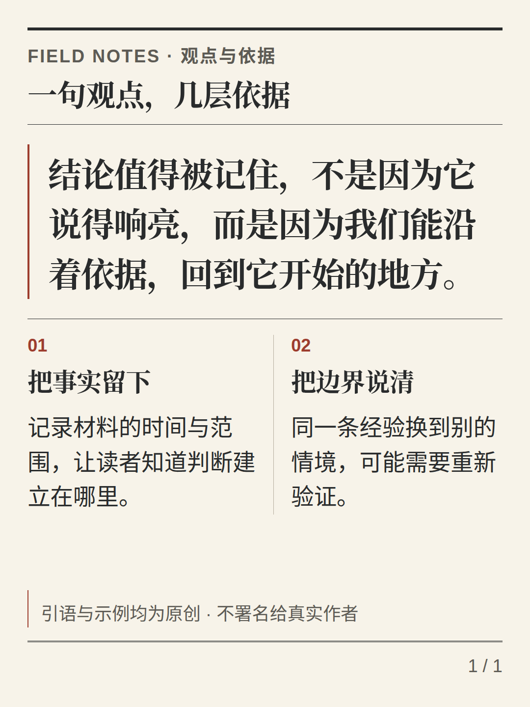](../docs/images/refinement-m2-run-40074554707/T02.png) <strong>用途：</strong>观点摘引、证据提示与出处说明 <strong>图片：</strong>无需图片 <strong>画幅：</strong>3:4 [Markdown 示例](../examples/templates/T02.md) |
| **T03 图文分栏人物与概念介绍**  <strong>用途：</strong>一张竖图配人物练习、工艺介绍或单一概念 <strong>图片：</strong>必需本地图片 <strong>画幅：</strong>3:4 [Markdown 示例](../examples/templates/T03.md) | **T04 专题长文分节** [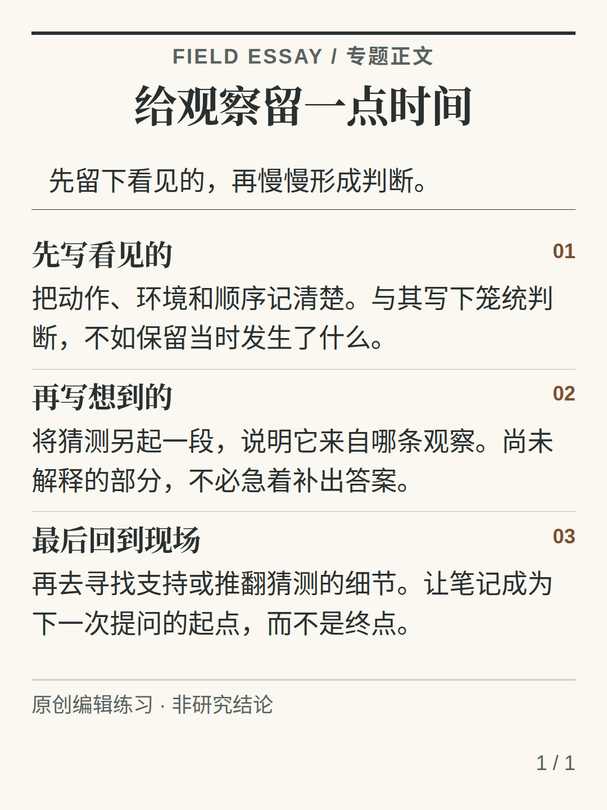](../docs/images/refinement-m2-run-40074554707/T04.png) <strong>用途：</strong>同一论点的连续说明、专题正文页与系列卡片 <strong>图片：</strong>无需图片 <strong>画幅：</strong>3:4 / 1:1 / 16:9 [Markdown 示例](../examples/templates/T04.md) |

查看这组模板的内容结构与使用限制

**T01 专题封面与侧栏导读**

- 结构：一个 H1；开篇段落；一至两个 H2 侧栏。
- 不适合：长文、宽表格和完整教程；可改用普通 explainer 分页。

**T02 引语特写与证据出处**

- 结构：一个 H1；一个 25–45 字的引用块；两个 H2 证据短栏；来源写入 source，避免重复署名。
- 不适合：长篇引文、三栏以上证据或宽表格；可拆成多张手动卡片，保留完整引文与出处。

**T03 图文分栏人物与概念介绍**

- 结构：一个 H1；一段短导语；两个短 H2；必须提供本地图片与说明。主文左侧、图片右侧，默认 contain 保全图片。
- 不适合：长访谈、多人群像、宽截图和长图注；不要靠裁切或缩字塞入侧栏。示例人物和场景为 AI 生成虚构内容。

**T04 专题长文分节**

- 结构：一个 H1；一句导语；三个 H2 短节，以连续全宽段落展开。较长全文须保留原文并手动拆卡。
- 不适合：超长单段、宽表格和并排论点；这是正文优先设计，不代表单张容纳任意长文。

## 瑞士极简

| 模板效果 | 模板效果 |
| --- | --- |
| **T05 大数字索引清单**  <strong>用途：</strong>方法清单、阅读导航 <strong>图片：</strong>无需图片 <strong>画幅：</strong>3:4 / 1:1 [Markdown 示例](../examples/templates/T05.md) | **T06 非对称双栏对比** [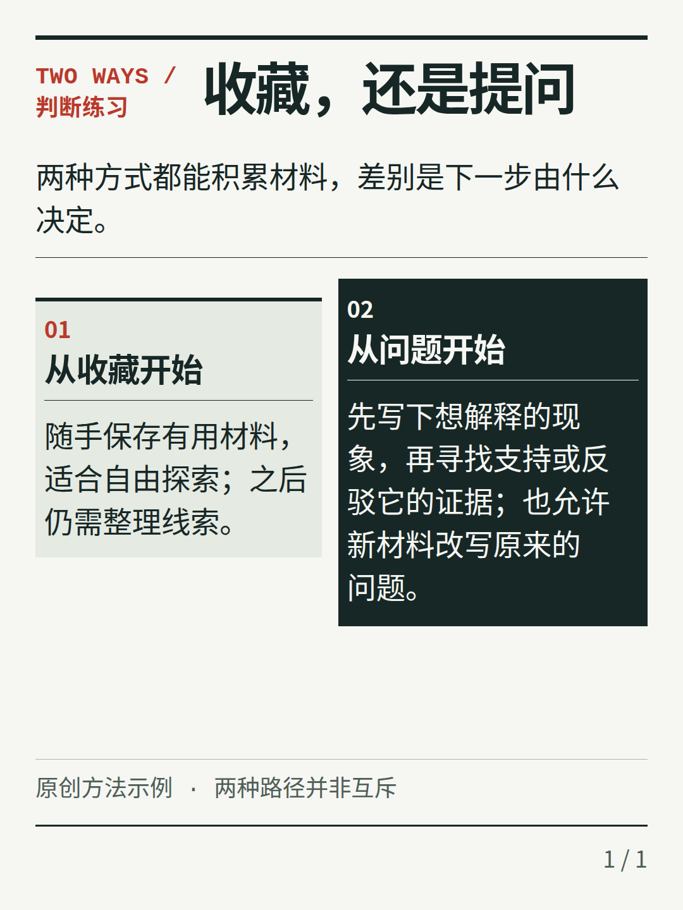](../docs/images/refinement-m2-run-40074554707/T06.png) <strong>用途：</strong>两种方案、路径或判断方式的比较 <strong>图片：</strong>无需图片 <strong>画幅：</strong>3:4 [Markdown 示例](../examples/templates/T06.md) |
| **T07 网格知识地图** [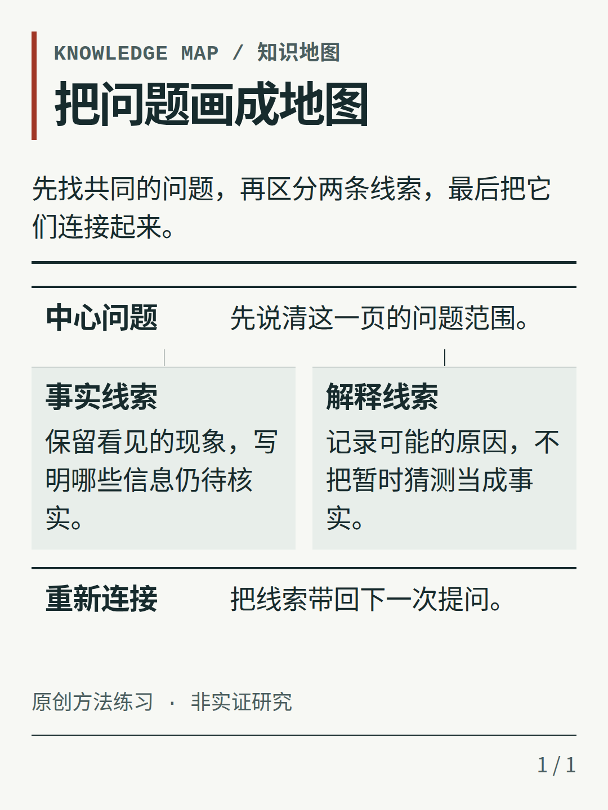](../docs/images/refinement-m2-run-40074554707/T07.png) <strong>用途：</strong>概念总览、根问题与两条分支的知识地图 <strong>图片：</strong>无需图片 <strong>画幅：</strong>3:4 [Markdown 示例](../examples/templates/T07.md) | **T08 极简步骤导航** [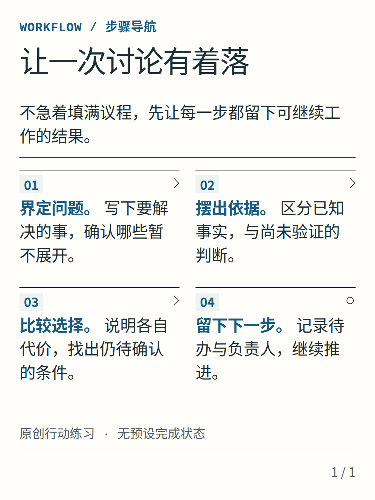](../docs/images/refinement-m2-run-40074554707/T08.png) <strong>用途：</strong>准备、执行与回看的短步骤路线 <strong>图片：</strong>无需图片 <strong>画幅：</strong>3:4 [Markdown 示例](../examples/templates/T08.md) |

查看这组模板的内容结构与使用限制

**T05 大数字索引清单**

- 结构：一个 H1；三至四个完整有序列表项。保留原始起始编号；本模板编号范围为 0–99，超出请用普通 steps。
- 不适合：长嵌套列表或大段说明；可用普通 steps 自动分页。

**T06 非对称双栏对比**

- 结构：一个 H1；一段简短比较前提；两个接近等宽的 H2 对比栏，右栏保留较强视觉权重；后续 H2 为全宽补充。
- 不适合：三个以上并列方案、长嵌套列表和宽表格；改用普通 comparison 多卡对比。

**T07 网格知识地图**

- 结构：一个 H1；一句问题前提；四个 H2，依次为全宽根概念、两个并列分支、全宽综合。阅读顺序沿原文。
- 不适合：四个完全等价的分类、三层以上树状结构、宽表格；等价四分类可改用 T12。

**T08 极简步骤导航**

- 结构：一个 H1；一句导语；四个完整有序列表项，按先左后右、再到下一行阅读。原始编号保留，范围为 0–99。
- 不适合：长嵌套清单、超过四个很长的步骤、超过两位的编号；可用普通 steps 分页。箭头与末项圆圈仅为导航装饰。

## 包豪斯几何

| 模板效果 | 模板效果 |
| --- | --- |
| **T09 几何主题封面**  <strong>用途：</strong>概念专题开篇、工作坊主题与方法导读 <strong>图片：</strong>无需图片 <strong>画幅：</strong>3:4 [Markdown 示例](../examples/templates/T09.md) | **T10 模块拼贴概念卡** [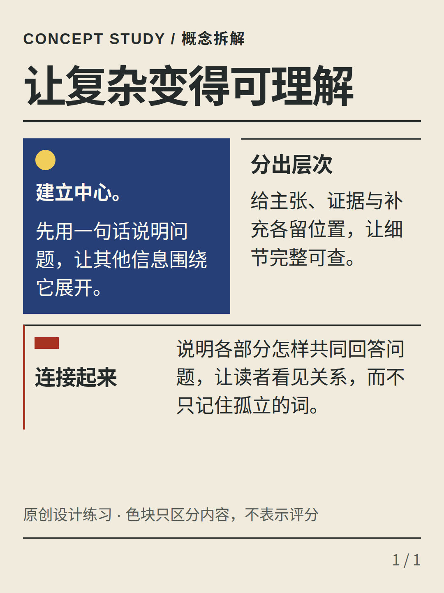](../docs/images/refinement-m2-run-40074554707/T10.png) <strong>用途：</strong>概念拆解、设计原则与三段式知识介绍 <strong>图片：</strong>无需图片 <strong>画幅：</strong>3:4 [Markdown 示例](../examples/templates/T10.md) |
| **T11 圆形节点流程** [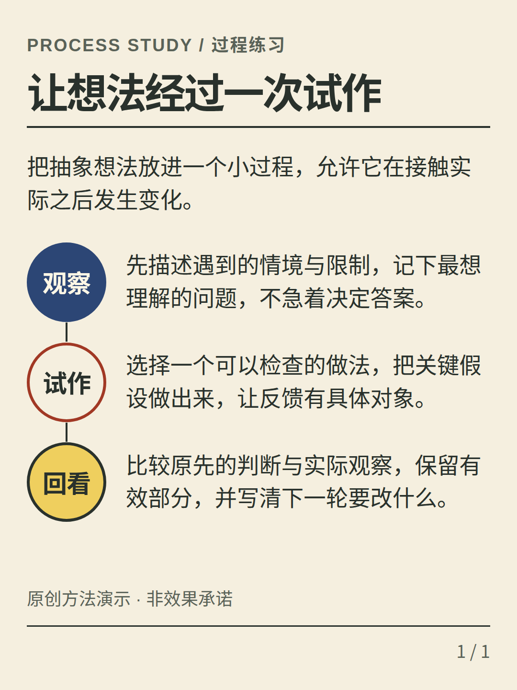](../docs/images/refinement-m2-run-40074554707/T11.png) <strong>用途：</strong>三阶段观察、试作、反馈或概念转化过程 <strong>图片：</strong>无需图片 <strong>画幅：</strong>3:4 [Markdown 示例](../examples/templates/T11.md) | **T12 几何分区四象限** [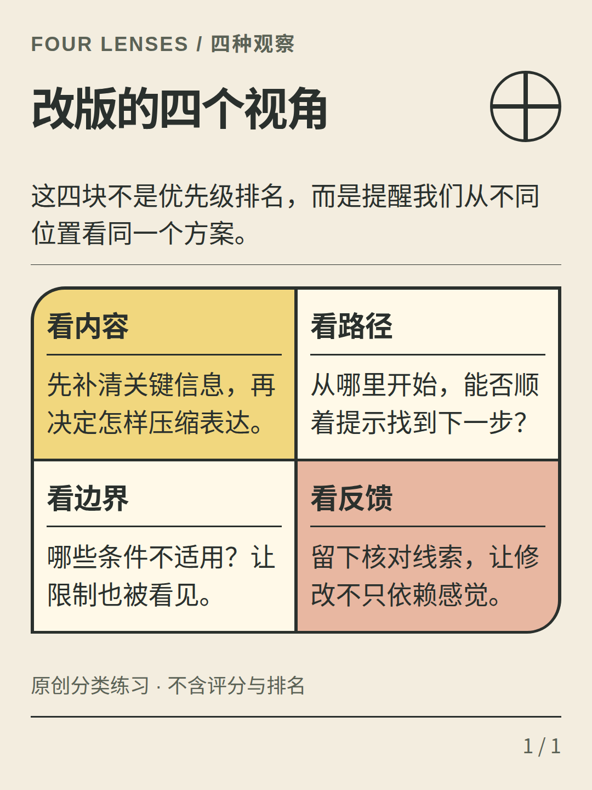](../docs/images/refinement-m2-run-40074554707/T12.png) <strong>用途：</strong>四种平行情况、原则分类或四方向观察 <strong>图片：</strong>无需图片 <strong>画幅：</strong>3:4 [Markdown 示例](../examples/templates/T12.md) |

查看这组模板的内容结构与使用限制

**T09 几何主题封面**

- 结构：一个 6–10 字 H1；一段导语；两个 H2 短节。圆弧为标题留出独立区域，几何标记区分两段。
- 不适合：长标题、详细教程与密集数据；改用解释卡，不缩小正文来填入封面。

**T10 模块拼贴概念卡**

- 结构：一个 H1；一段概念导语；两个 H2。导语与第一节并列，第二节为全宽综合模块。
- 不适合：宽表格、长代码和层层嵌套的论证；可改用普通 explainer 分页。

**T11 圆形节点流程**

- 结构：一个 H1；一句导语；三个 H2，每个标题建议 2 字，直接成为圆形节点文字；完整说明排列在节点右侧。
- 不适合：长节点标题、分支决策树或大量阶段；长标题会使节点自然变高，不会缩字或截断。

**T12 几何分区四象限**

- 结构：一个 H1；一句分类前提；四个 H2 组成等宽四分区，按原文行序阅读。没有隐含坐标、得分或排名。
- 不适合：数值散点、需要明确坐标轴的矩阵或五个以上等价分类；附加 H2 保留为全宽补充，不冒充第五象限。

## 新粗野海报

| 模板效果 | 模板效果 |
| --- | --- |
| **T13 超大字宣言**  <strong>用途：</strong>行动主张、团队原则与明确的核心观点 <strong>图片：</strong>无需图片 <strong>画幅：</strong>3:4 / 1:1 [Markdown 示例](../examples/templates/T13.md) | **T14 票据式行动清单** [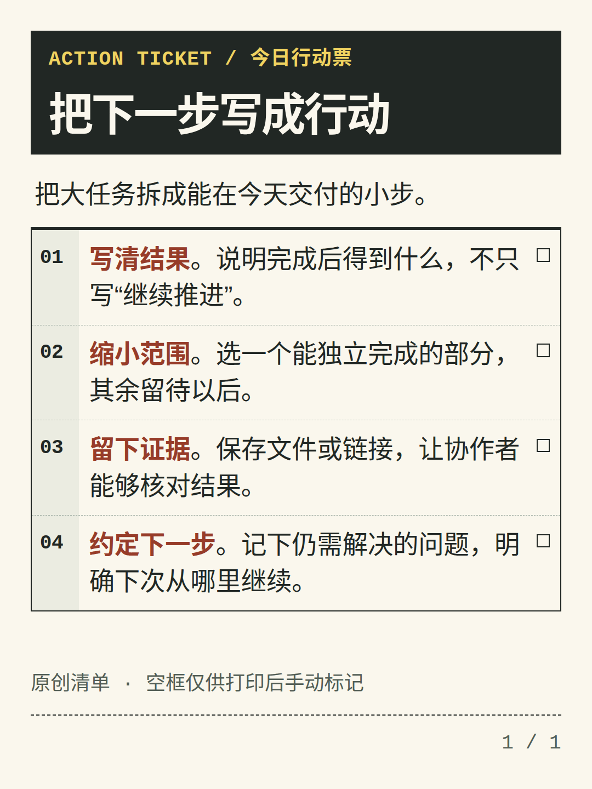](../docs/images/refinement-m2-run-40074554707/T14.png) <strong>用途：</strong>执行前检查、个人行动清单与打印任务票 <strong>图片：</strong>无需图片 <strong>画幅：</strong>3:4 [Markdown 示例](../examples/templates/T14.md) |
| **T15 粗线双阵营对照** [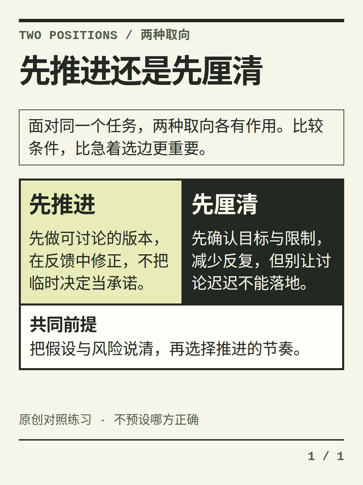](../docs/images/refinement-m2-run-40074554707/T15.png) <strong>用途：</strong>两种取向的公平对照及共同适用边界 <strong>图片：</strong>无需图片 <strong>画幅：</strong>3:4 [Markdown 示例](../examples/templates/T15.md) | **T16 黑白撞色观点合集** [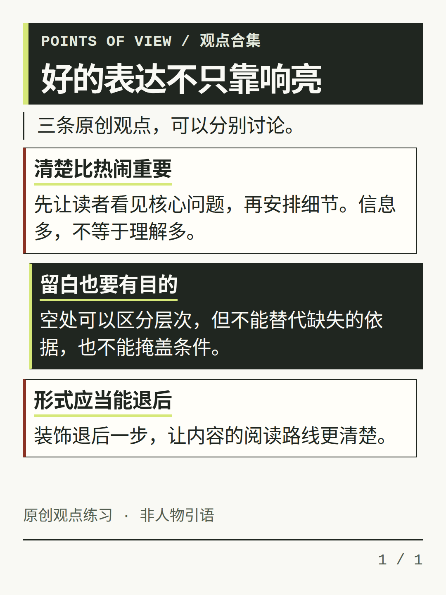](../docs/images/refinement-m2-run-40074554707/T16.png) <strong>用途：</strong>同题短观点、创作原则与独立立场摘记 <strong>图片：</strong>无需图片 <strong>画幅：</strong>3:4 [Markdown 示例](../examples/templates/T16.md) |

查看这组模板的内容结构与使用限制

**T13 超大字宣言**

- 结构：一个 6–10 字 H1 或连续 H1 标题组；一段导语；两个短 H2 论点条，标题以 2–4 字为宜。
- 不适合：长标题、细节密集的政策与完整教程；拆卡并保留条件，不将宣言当作完整论证。

**T14 票据式行动清单**

- 结构：一个 H1；一句短导语；三至四项完整有序列表。编号保留输入起点，空框仅供打印后手动勾选。 本模板支持原始编号 0–99；超出请使用普通 steps。
- 不适合：长嵌套任务、需要交互状态的待办应用；可用普通 steps 分页，不自动标记完成。

**T15 粗线双阵营对照**

- 结构：一个 H1；一句比较前提；两个 H2 等宽阵营；第三个 H2 为全宽共同条件。不同底色不代表胜负。
- 不适合：三个以上方案、长条款及把复杂争议强行二分；完整限制须保留在补充区或下一张卡。

**T16 黑白撞色观点合集**

- 结构：一个 H1；一句总前提；三个 H2 原创短观点，每节标题上置、说明下置。交错纸片与点色区分观点。
- 不适合：长篇人物引语、需要逐条出处的学术汇编；外部引语必须提供真实出处，不用样例冒充名言。

## 深色科技

| 模板效果 | 模板效果 |
| --- | --- |
| **T17 荧光重点机制解析** [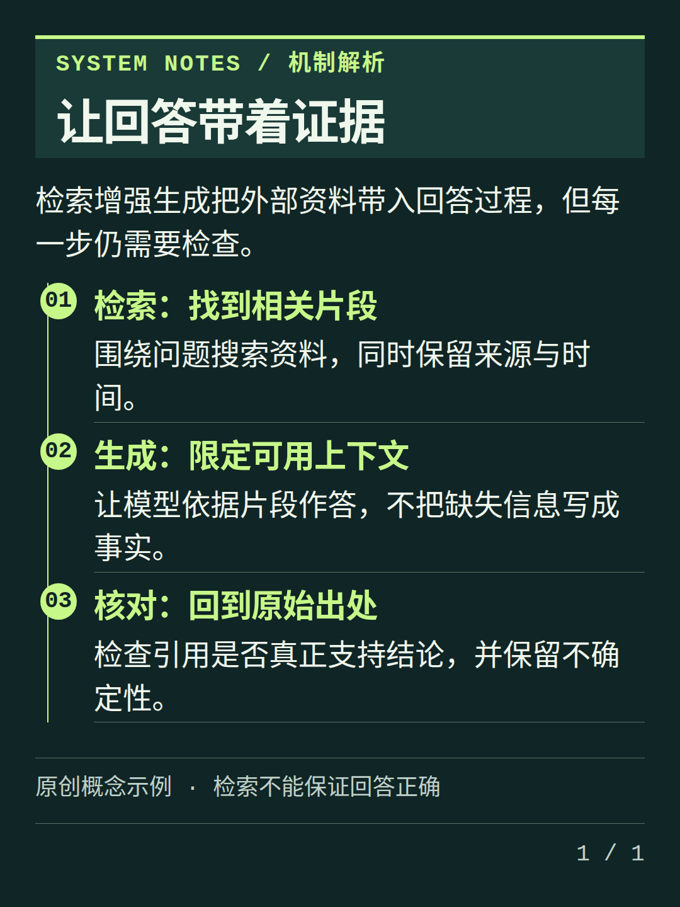](../docs/images/refinement-m2-run-40074554707/T17.png) <strong>用途：</strong>机制、原理与系统解释 <strong>图片：</strong>无需图片 <strong>画幅：</strong>3:4 [Markdown 示例](../examples/templates/T17.md) | **T18 终端式技术教程** [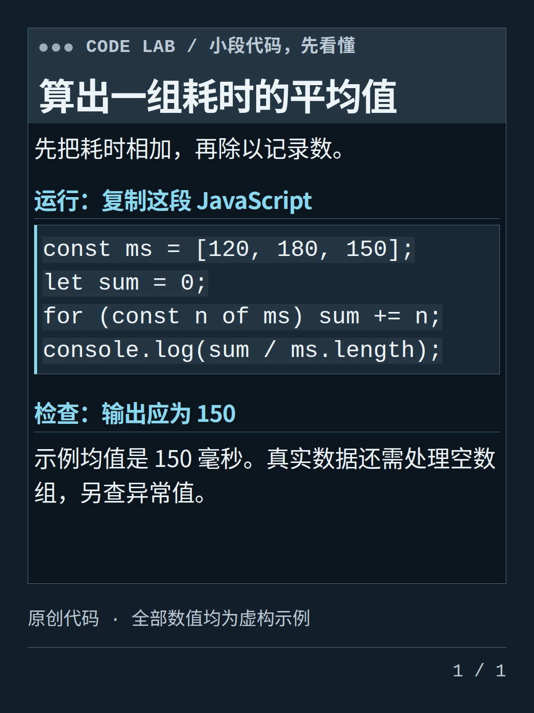](../docs/images/refinement-m2-run-40074554707/T18.png) <strong>用途：</strong>短代码演示、命令操作与结果核对 <strong>图片：</strong>无需图片 <strong>画幅：</strong>3:4 [Markdown 示例](../examples/templates/T18.md) |
| **T19 系统模块架构**  <strong>用途：</strong>解释系统的模块边界、输入与职责 <strong>图片：</strong>无需图片 <strong>画幅：</strong>3:4 [Markdown 示例](../examples/templates/T19.md) | **T20 深色产品功能展示** [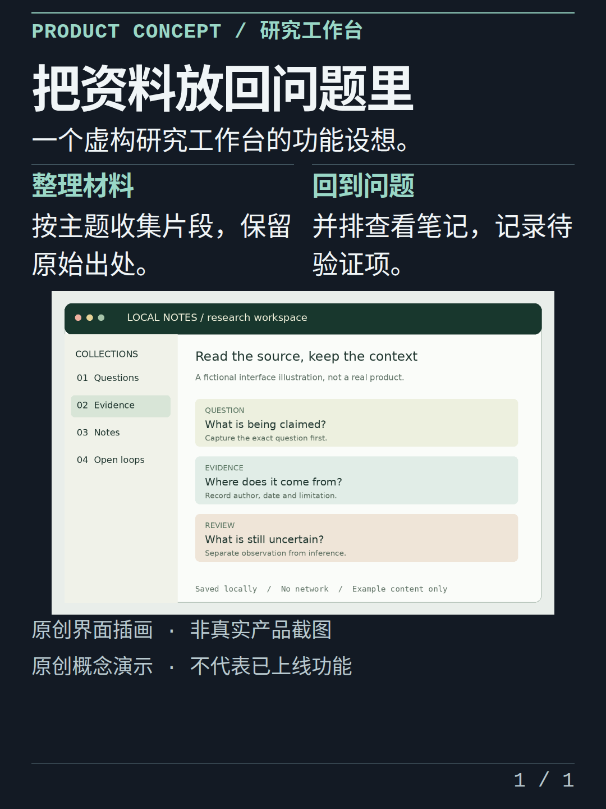](../docs/images/refinement-m2-run-40074554707/T20.png) <strong>用途：</strong>展示产品主张、两个功能与一幅完整界面图 <strong>图片：</strong>必需本地图片 <strong>画幅：</strong>3:4 [Markdown 示例](../examples/templates/T20.md) |

查看这组模板的内容结构与使用限制

**T17 荧光重点机制解析**

- 结构：一个 H1；简短导语；三段 H2 机制说明。
- 不适合：长代码或宽表格；可改用技术教程模板或普通 explainer。

**T18 终端式技术教程**

- 结构：一个 H1；简短导语；两个 H2 分别放真实代码和结果说明。建议一段不超过六行的短代码。
- 不适合：长函数、超长命令或宽表格；请拆成手动卡片或使用普通 explainer 自动分页，不缩小代码。

**T19 系统模块架构**

- 结构：一个 H1；导语说明系统输入；四个 H2 分别命名模块并说明职责，形成两列两行的模块矩阵。模块顺序沿用原文。
- 不适合：复杂拓扑、长 API 清单或需要真实箭头语义的架构图；请提供专门图示或拆为手动卡片，不用装饰冒充连接关系。

**T20 深色产品功能展示**

- 结构：一个 H1；一句导语；两个 H2 功能短说明；image 必须提供本地图片，alt 与 caption 说明图像性质。按标题、正文、图像、来源的 DOM 顺序展示。
- 不适合：需要在手机上阅读密集界面小字、长功能列表或无图内容；图内细节不能代替图外正文，请改用专门界面细节卡或文本模板。

## 数据与商业

| 模板效果 | 模板效果 |
| --- | --- |
| **T21 单指标聚焦**  <strong>用途：</strong>突出一个指标，同时交代定义、范围与限制 <strong>图片：</strong>无需图片 <strong>画幅：</strong>3:4 / 1:1 / 16:9 / 21:9 [Markdown 示例](../examples/templates/T21.md) | **T22 三指标证据板** [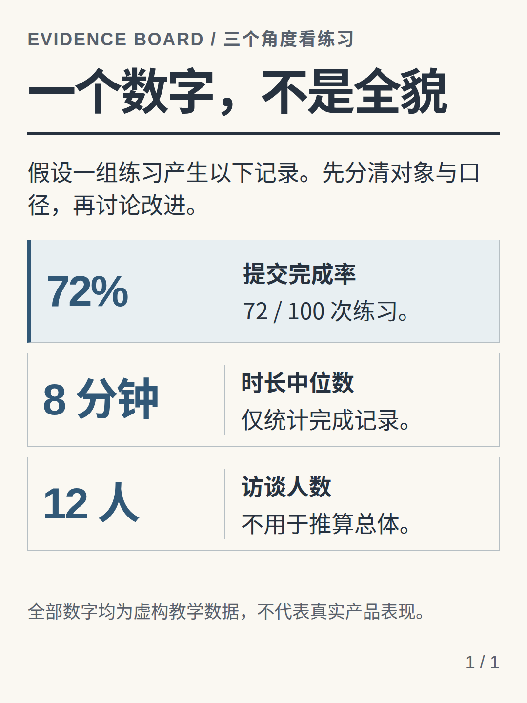](../docs/images/refinement-m2-run-40074554707/T22.png) <strong>用途：</strong>用三组指标与证据说明同一问题 <strong>图片：</strong>无需图片 <strong>画幅：</strong>3:4 [Markdown 示例](../examples/templates/T22.md) |
| **T23 问题—行动—结果案例** [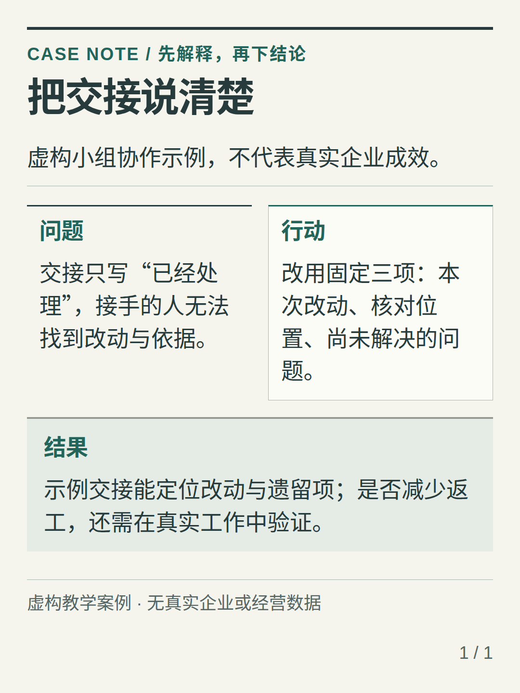](../docs/images/refinement-m2-run-40074554707/T23.png) <strong>用途：</strong>说明案例背景、行动与有依据的结果边界 <strong>图片：</strong>无需图片 <strong>画幅：</strong>3:4 [Markdown 示例](../examples/templates/T23.md) | **T24 报告式对比表** [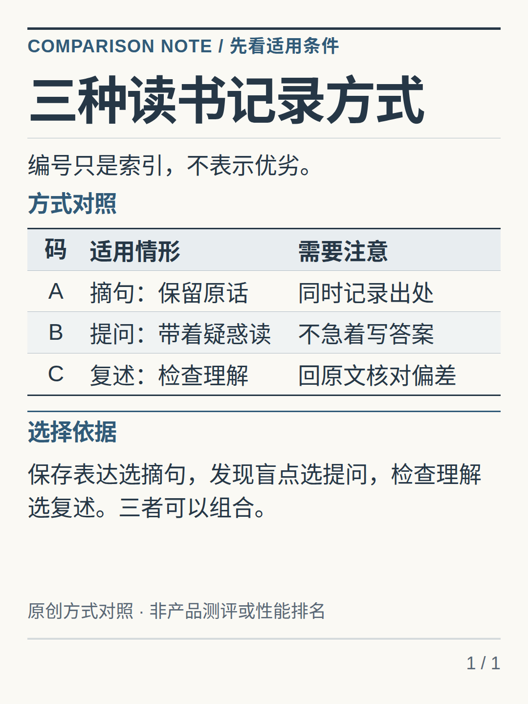](../docs/images/refinement-m2-run-40074554707/T24.png) <strong>用途：</strong>用真实三列表格对照方式、适用情形与限制 <strong>图片：</strong>无需图片 <strong>画幅：</strong>3:4 / 16:9 [Markdown 示例](../examples/templates/T24.md) |

查看这组模板的内容结构与使用限制

**T21 单指标聚焦**

- 结构：必须提供非空 metric 和 label；一个 H1；metric 和 label 提供指标与完整名称；导语后用两个 H2 分别说明口径与限制。
- 不适合：多个竞争指标、超长数值、缺少分母或依据的数据；可改用 T22 或普通 explainer。

**T22 三指标证据板**

- 结构：一个 H1；简短导语；恰好三个 H2，每个 H2 写短指标值，其后一个段落以加粗指标名开头，再说明分母或限定条件。
- 不适合：需要横轴刻度的图表、超过三个指标或长篇方法学；请使用数据图或普通 explainer，不伪造指标凑版。

**T23 问题—行动—结果案例**

- 结构：一个 H1；导语交代案例性质；三个 H2 依次为问题、行动和结果。前两节并列，结果跨栏；假设或示例需明确标注。
- 不适合：没有来源的企业业绩、虚构真实公司成效、需要多指标证据的方法学报告；保留证据与限制，必要时改用多卡案例。

**T24 报告式对比表**

- 结构：一个 H1；短导语；第一 H2 下为三列表格，第一列只放 1–2 位代码或短数字，后两列为解释；第二 H2 写选择依据。推荐三行表体，全文保持正文字号。
- 不适合：长名称首列、超过三列的宽表、长表体或大段单元格；请用其他表格卡或手动分卡，不缩小单元格和代码。

## 温暖手账

| 模板效果 | 模板效果 |
| --- | --- |
| **T25 便签式阅读摘记**  <strong>用途：</strong>阅读笔记、摘句与思考 <strong>图片：</strong>无需图片 <strong>画幅：</strong>3:4 [Markdown 示例](../examples/templates/T25.md) | **T26 批注式学习清单** [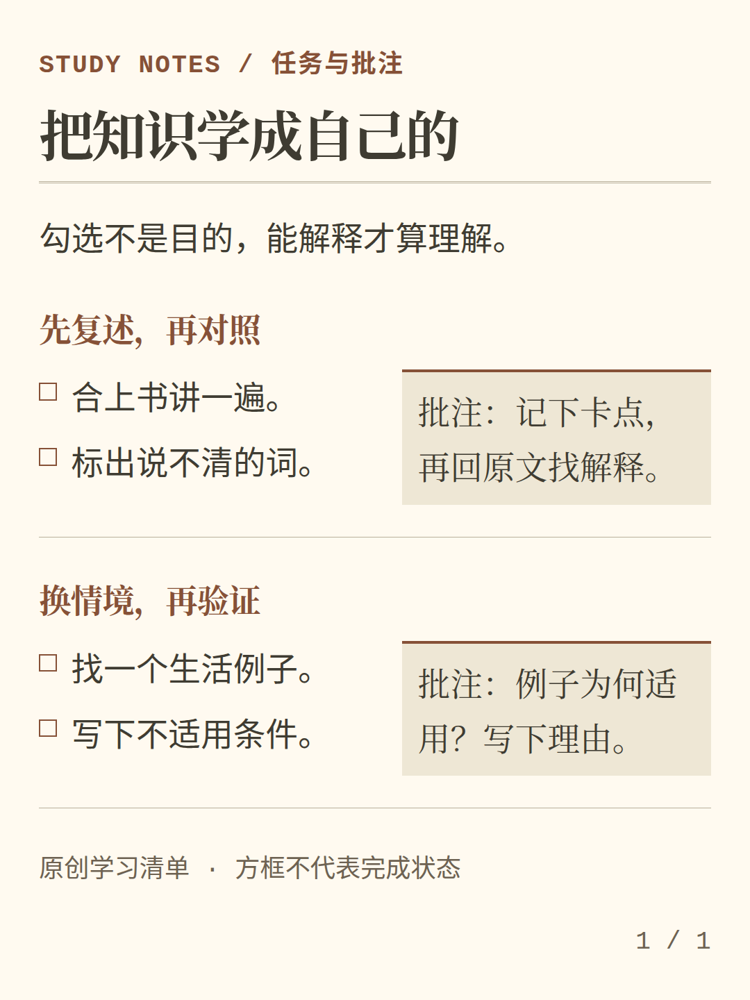](../docs/images/refinement-m2-run-40074554707/T26.png) <strong>用途：</strong>学习任务、复习清单与对应批注 <strong>图片：</strong>无需图片 <strong>画幅：</strong>3:4 [Markdown 示例](../examples/templates/T26.md) |
| **T27 时间线学习计划** [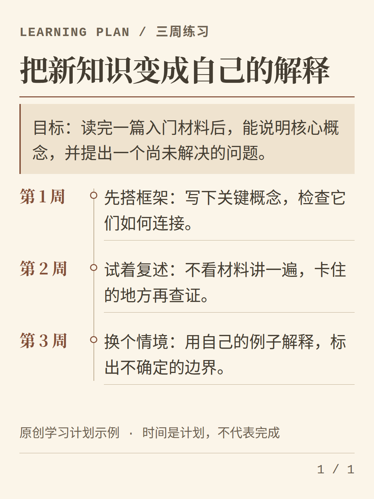](../docs/images/refinement-m2-run-40074554707/T27.png) <strong>用途：</strong>按阶段整理学习目标、练习与检验方式 <strong>图片：</strong>无需图片 <strong>画幅：</strong>3:4 [Markdown 示例](../examples/templates/T27.md) | **T28 索引卡知识整理** [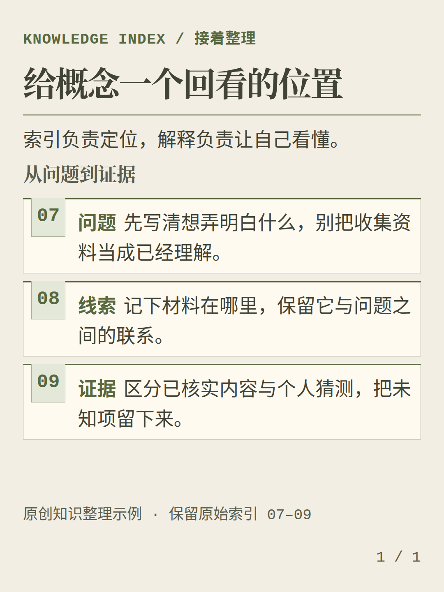](../docs/images/refinement-m2-run-40074554707/T28.png) <strong>用途：</strong>用稳定索引整理概念、定义与回看线索 <strong>图片：</strong>无需图片 <strong>画幅：</strong>3:4 [Markdown 示例](../examples/templates/T28.md) |

查看这组模板的内容结构与使用限制

**T25 便签式阅读摘记**

- 结构：一个 H1；引用块；一个 H2 下的阅读思考。
- 不适合：密集数据、长篇引用；保留完整引文并增加手动卡片。

**T26 批注式学习清单**

- 结构：一个 H1；一句导语；两个 H2，每节包含两项简短无序清单及一个批注引用块。空方框是项目符号，不代表已完成。
- 不适合：长嵌套任务、需要交互勾选或批注大于正文的内容；可改用普通 steps 或 explainer 分页。

**T27 时间线学习计划**

- 结构：一个 H1；导语写总目标；三个 H2 使用作者提供的短时间标签，如第 1 周；各自一个段落写任务与检验。时间不由模板生成。
- 不适合：精确排程、交互进度、多层子任务或过长日期；请转用日历或普通 steps，不把计划显示成已完成。

**T28 索引卡知识整理**

- 结构：一个 H1；短导语；一个 H2 下放三个有序列表项，每项以加粗概念开头，再写解释。编号来自原始列表；固定索引签仅支持 0–99。
- 不适合：超过 99 的编号、长嵌套列表或多段长定义；改用普通 steps 或分卡，保留原始编号，不重置为 1。

## 东方书卷

| 模板效果 | 模板效果 |
| --- | --- |
| **T29 题签留白书摘**  <strong>用途：</strong>短书摘、原创语句与独立阅读理解 <strong>图片：</strong>无需图片 <strong>画幅：</strong>3:4 [Markdown 示例](../examples/templates/T29.md) | **T30 横排诗文与小景** [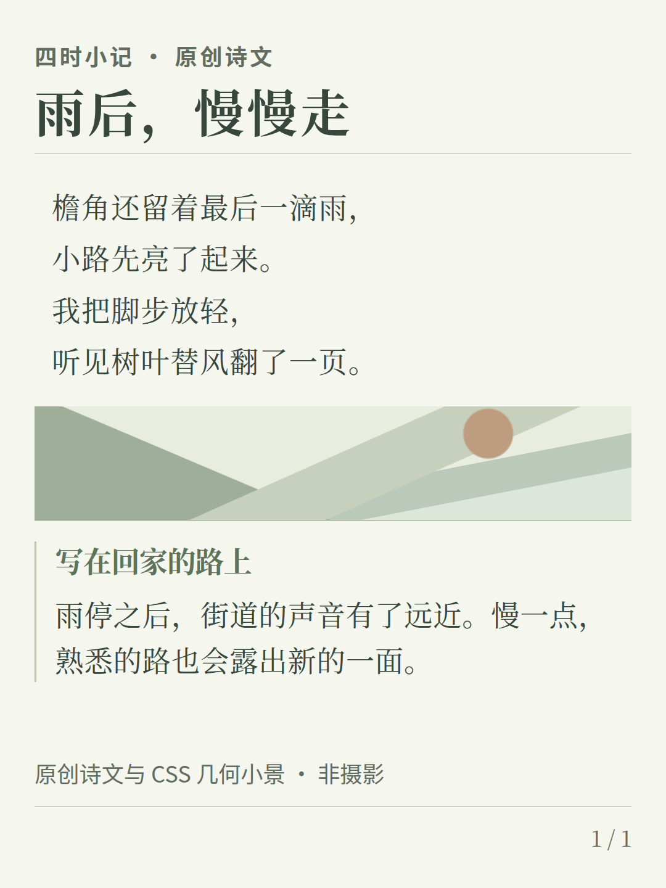](../docs/images/refinement-m2-run-40074554707/T30.png) <strong>用途：</strong>短诗、散文片段与安静的创作札记 <strong>图片：</strong>无需图片 <strong>画幅：</strong>3:4 [Markdown 示例](../examples/templates/T30.md) |
| **T31 印章式个人语录** [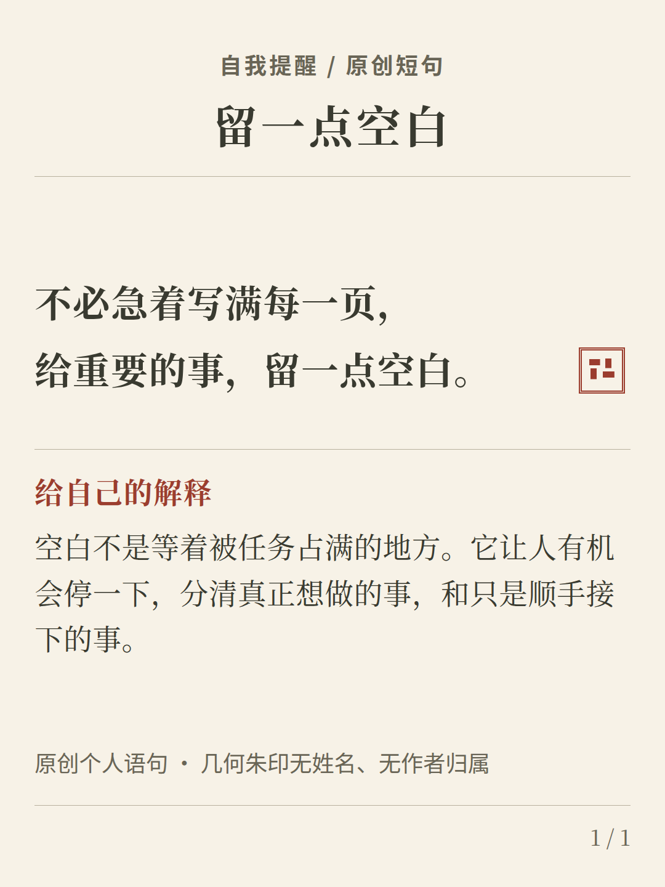](../docs/images/refinement-m2-run-40074554707/T31.png) <strong>用途：</strong>呈现个人短句、真实人物原话与独立思考 <strong>图片：</strong>无需图片 <strong>画幅：</strong>3:4 [Markdown 示例](../examples/templates/T31.md) | **T32 书页章节解读** [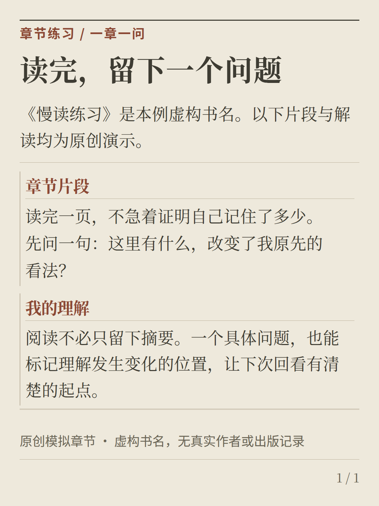](../docs/images/refinement-m2-run-40074554707/T32.png) <strong>用途：</strong>区分章节摘句与读者解读，保留作品来源 <strong>图片：</strong>无需图片 <strong>画幅：</strong>3:4 [Markdown 示例](../examples/templates/T32.md) |

查看这组模板的内容结构与使用限制

**T29 题签留白书摘**

- 结构：一个短 H1；保留原始断句的引用块；一个 H2 下放个人理解；source 记录真实出处或原创身份。
- 不适合：长篇节选、无法核对的名人语录和多级列表；不改句意、不虚构署名、不强制竖排。

**T30 横排诗文与小景**

- 结构：一个 H1；引用块放四至六行横排诗文，并用 Markdown 硬换行保留行分隔；一个 H2 放札记；小景为模板自带原创 CSS 几何构图。
- 不适合：长诗、要求原作插图或真实摄影的图文；请另选图文模板，不把几何小景当作照片。

**T31 印章式个人语录**

- 结构：一个短 H1；引用块保留原始断句；一个 H2 下写个人理解。source 只记真实出处或原创身份；朱印仅为空白几何装饰，不生成作者姓名。
- 不适合：无法核实的人物语录、长篇书摘或要求真实印鉴的内容；不虚构作者、印文或归属，必要时使用普通 quote。

**T32 书页章节解读**

- 结构：一个 H1；导语交代章节语境；两个 H2 分别放短引用块与个人理解，形成前后成对的全宽阅读带。引用与解读不能互相冒充。
- 不适合：整章复制、长篇节选、窄栏长代码与不明出处文本；使用获授权的短摘句，或明确原创演示并手动分卡。

## 复古报刊

| 模板效果 | 模板效果 |
| --- | --- |
| **T33 报头式主题导读** [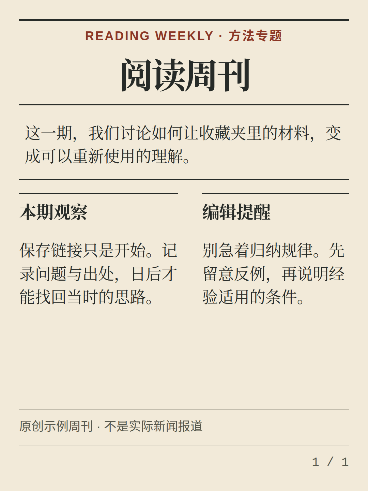](../docs/images/refinement-m2-run-40074554707/T33.png) <strong>用途：</strong>专题导读、读书周刊 <strong>图片：</strong>无需图片 <strong>画幅：</strong>3:4 [Markdown 示例](../examples/templates/T33.md) | **T34 专栏式观点分析** [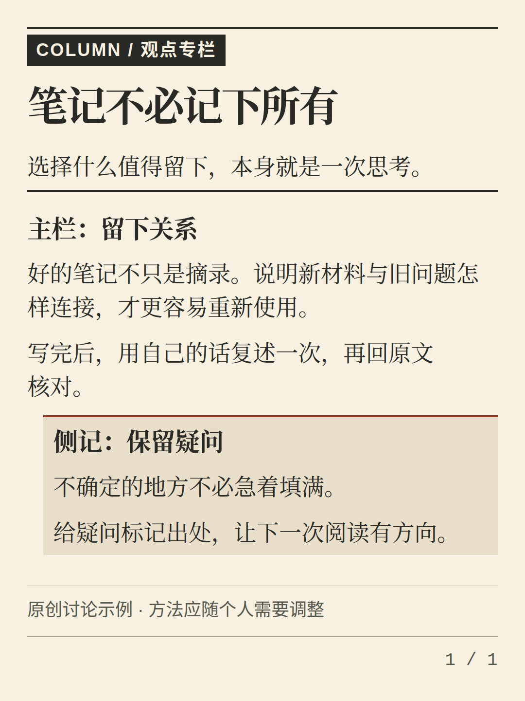](../docs/images/refinement-m2-run-40074554707/T34.png) <strong>用途：</strong>观点分析与方法讨论 <strong>图片：</strong>无需图片 <strong>画幅：</strong>3:4 [Markdown 示例](../examples/templates/T34.md) |
| **T35 剪报拼贴资料卡**  <strong>用途：</strong>并列保存资料片段、记录日期和各自出处 <strong>图片：</strong>无需图片 <strong>画幅：</strong>3:4 [Markdown 示例](../examples/templates/T35.md) | **T36 大标题事件回顾** [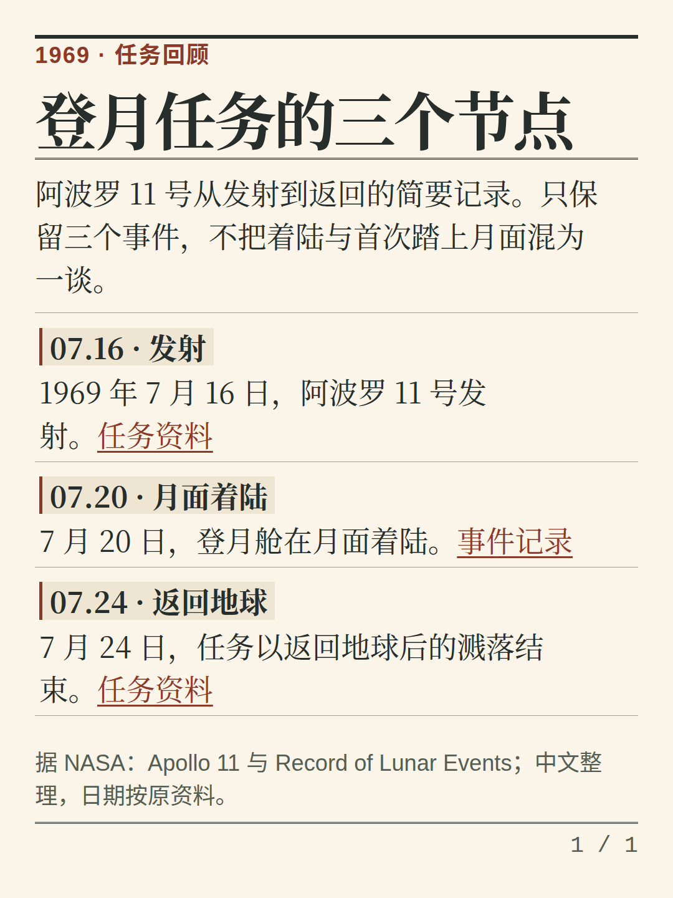](../docs/images/refinement-m2-run-40074554707/T36.png) <strong>用途：</strong>用大标题、真实日期和连续事实记录回顾事件 <strong>图片：</strong>无需图片 <strong>画幅：</strong>3:4 [Markdown 示例](../examples/templates/T36.md) |

查看这组模板的内容结构与使用限制

**T33 报头式主题导读**

- 结构：一个 H1 报头；一段导语；两个 H2 栏目。
- 不适合：密集长文与多列表格；用普通解释卡分页。

**T34 专栏式观点分析**

- 结构：一个 H1；短导语；两个 H2，分别为全宽主栏与缩进侧记。
- 不适合：长引文与复杂嵌套；保留原文手动分卡。

**T35 剪报拼贴资料卡**

- 结构：一个 H1；短导语；两个 H2 资料片段，每节依次写明确日期/出处、引用块与必要边界。片段来源不得被省略或拼成新结论。
- 不适合：未注明来源的摘句、需要暗示因果的拼贴或长篇全文；原文过长请手动分卡。

**T36 大标题事件回顾**

- 结构：一个 H1 事件标题；导语说明范围；三个 H2 包含作者提供的日期与事件名称；各节保留事实及资料链接。模板不生成日期或事实。
- 不适合：没有来源的事件结论、跨时区却不注明口径的精确时间、宣传口号；不把未验证消息当事实。

## 胶片摄影

| 模板效果 | 模板效果 |
| --- | --- |
| **T37 大图与底部信息带**  <strong>用途：</strong>影像记录、照片与短故事 <strong>图片：</strong>必需本地图片 <strong>画幅：</strong>3:4 / 16:9 [Markdown 示例](../examples/templates/T37.md) | **T38 接触印样式记录**  <strong>用途：</strong>多图观察、过程记录 <strong>图片：</strong>必需正文图片 <strong>画幅：</strong>3:4 [Markdown 示例](../examples/templates/T38.md) |
| **T39 人像与侧栏故事**  <strong>用途：</strong>让完整人像成为主区，标题、故事与署名占据同一侧栏 <strong>图片：</strong>必需本地图片 <strong>画幅：</strong>3:4 [Markdown 示例](../examples/templates/T39.md) | **T40 局部特写与知识注释** [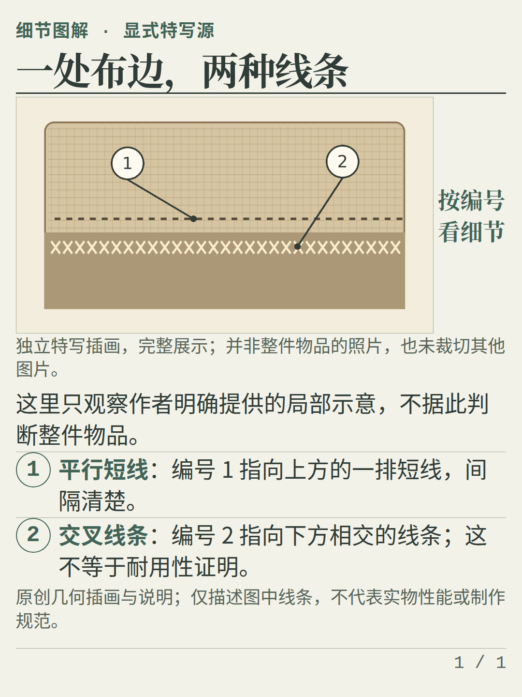](../docs/images/refinement-m2-run-40074554707/T40.png) <strong>用途：</strong>把明确选取的独立特写图与逐号注释对应 <strong>图片：</strong>必需本地图片 <strong>画幅：</strong>3:4 [Markdown 示例](../examples/templates/T40.md) |

查看这组模板的内容结构与使用限制

**T37 大图与底部信息带**

- 结构：元数据 image 为主要照片；一个 H1；简短故事；caption 和 source 说明图像性质与来源。
- 不适合：以大量文字为主的内容；用图文分栏或普通解释卡。

**T38 接触印样式记录**

- 结构：一个 H1；两个 H2 图像记录，每节一个 Markdown 本地图片与一句说明。保持 DOM 读序。
- 不适合：多于两幅的大型图集、长文；手动增加卡片，不隐藏图片。

**T39 人像与侧栏故事**

- 结构：必需本地人像 image、真实 alt 和说明性质的 caption；一个短 H1；短导语与一至两个 H2。标题与正文共用较宽的右侧叙述栏，完整人像在左侧贯穿两区。
- 不适合：无图人物报道、长传记、必须裁切才能成立的肖像；侧栏不是小字容器，保留主体或换图。

**T40 局部特写与知识注释**

- 结构：image 必须是明确提供的特写图，caption 交代它是独立细节源或经用户授权的预裁切图；一个 H1；简短导语与两至三个有序注释。原生编号保留，固定编号签范围 0–99。
- 不适合：未经授权裁切整图、把局部冒充全貌、图中编号与正文不匹配；当前模板不提供自动裁切。

## 糖果波普

| 模板效果 | 模板效果 |
| --- | --- |
| **T41 色块问答**  <strong>用途：</strong>问题解释、概念问答 <strong>图片：</strong>无需图片 <strong>画幅：</strong>3:4 [Markdown 示例](../examples/templates/T41.md) | **T42 贴纸式步骤卡** [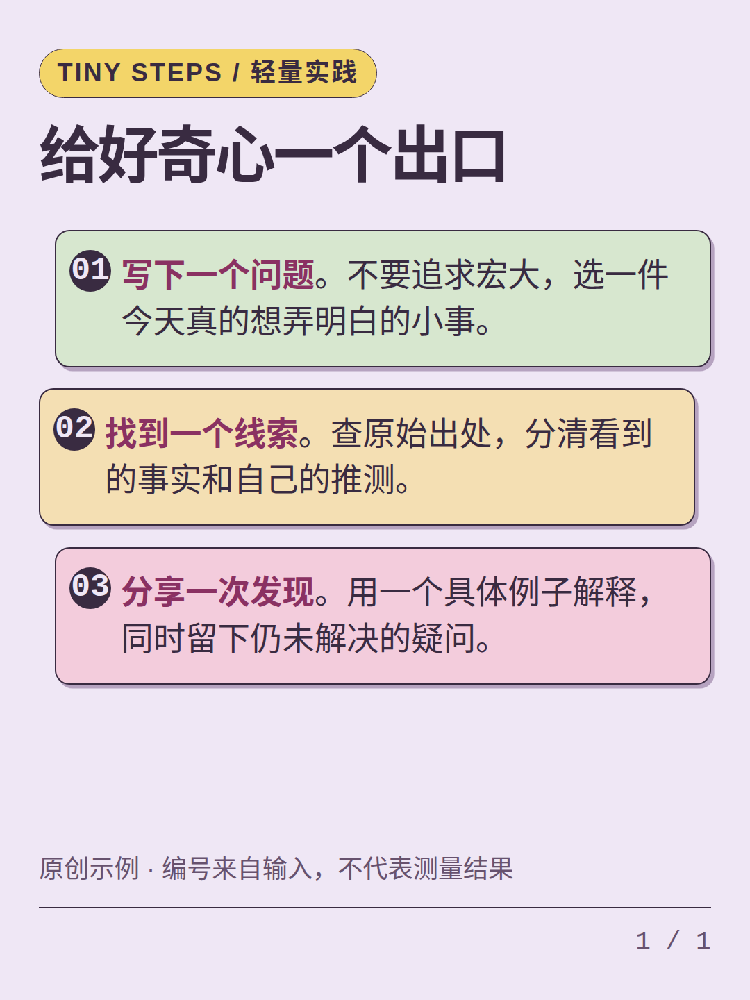](../docs/images/refinement-m2-run-40074554707/T42.png) <strong>用途：</strong>轻量教程、三步行动 <strong>图片：</strong>无需图片 <strong>画幅：</strong>3:4 [Markdown 示例](../examples/templates/T42.md) |
| **T43 漫画分镜知识解释** [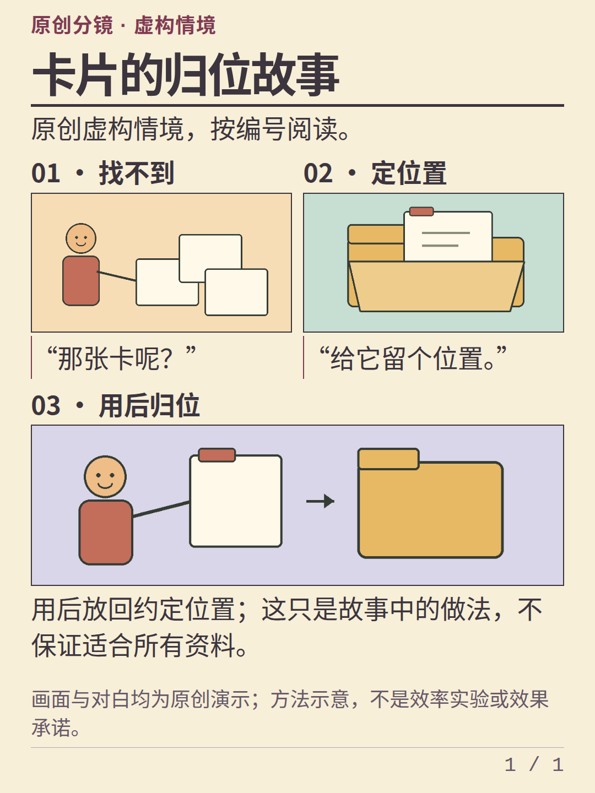](../docs/images/refinement-m2-run-40074554707/T43.png) <strong>用途：</strong>用原创分镜呈现明确的情境、做法与结论边界 <strong>图片：</strong>必需正文图片 <strong>画幅：</strong>3:4 [Markdown 示例](../examples/templates/T43.md) | **T44 趣味双选项对比** [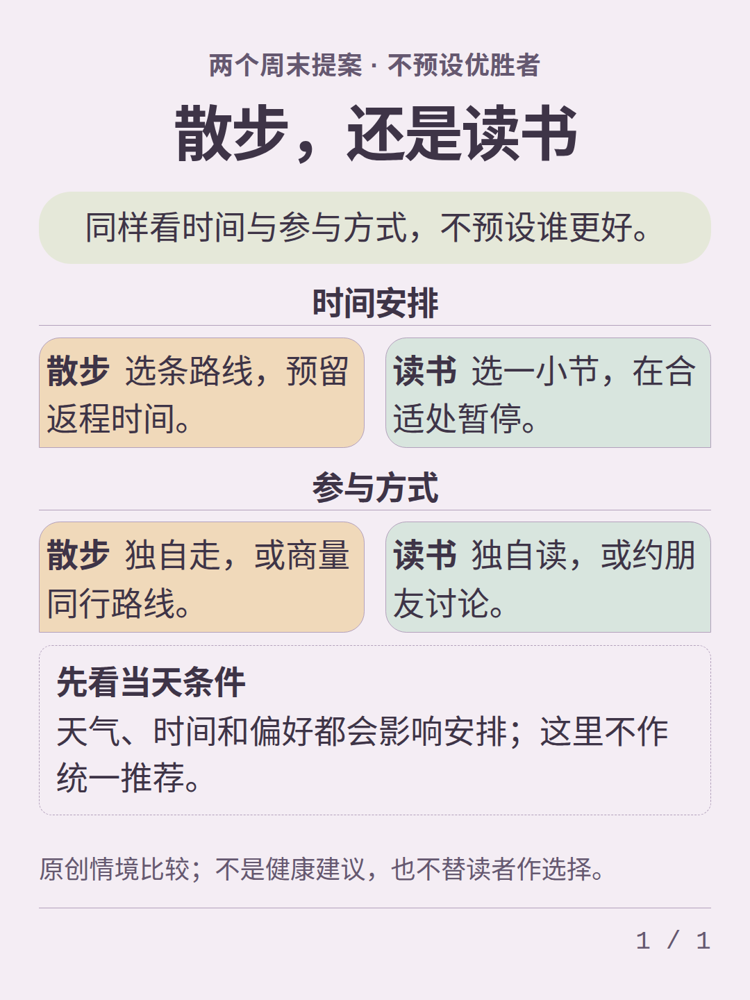](../docs/images/refinement-m2-run-40074554707/T44.png) <strong>用途：</strong>以同一维度逐行比较两个选项，不预设胜负 <strong>图片：</strong>无需图片 <strong>画幅：</strong>3:4 [Markdown 示例](../examples/templates/T44.md) |

查看这组模板的内容结构与使用限制

**T41 色块问答**

- 结构：H1 提出问题；导语说明背景；两个 H2 分别展开答案与边界。
- 不适合：长表格、代码和多层论证；改用对应专用模板。

**T42 贴纸式步骤卡**

- 结构：一个 H1；三个有序列表项；保留真实列表编号。 本模板支持原始编号 0–99，超出使用普通 steps。
- 不适合：密集嵌套步骤或代码；用技术教程或普通 steps 分页。

**T43 漫画分镜知识解释**

- 结构：一个 H1；导语标明情境性质；三个 H2 按作者给定编号排序，每节一个本地 Markdown 原创/许可图片与一个短对话或说明；第三格横贯两栏。
- 不适合：无许可漫画、连续长对白、图片数量与说明不一致，或为情节捏造事实；拆卡而非缩字。

**T44 趣味双选项对比**

- 结构：一个 H1；导语明确两个选项；前两个 H2 分别是比较维度，每节两个引用块，保留同顺序的显式选项标签；后续 H2 为全宽条件。
- 不适合：缺失一组选项、混用比较维度、评分推荐或过长气泡；不从缺失字段推断优劣。

## 自然生活

| 模板效果 | 模板效果 |
| --- | --- |
| **T45 植物留白笔记** [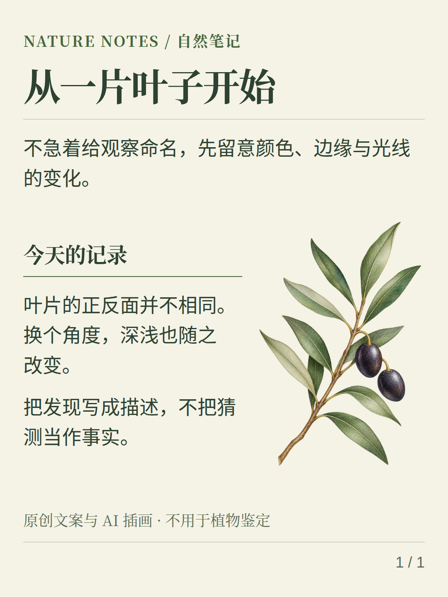](../docs/images/refinement-m2-run-40074554707/T45.png) <strong>用途：</strong>自然观察、生活笔记 <strong>图片：</strong>必需本地图片 <strong>画幅：</strong>3:4 [Markdown 示例](../examples/templates/T45.md) | **T46 暖色材料质感指南** [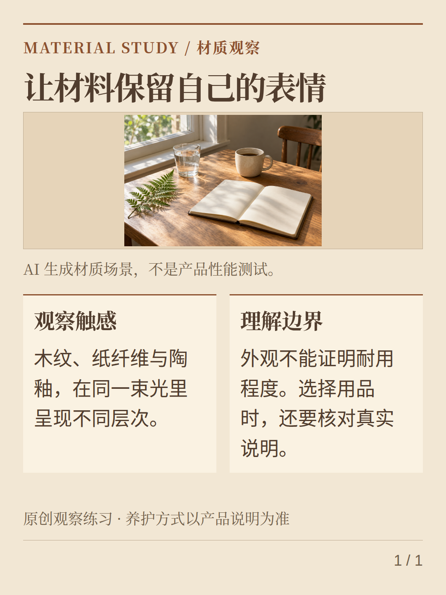](../docs/images/refinement-m2-run-40074554707/T46.png) <strong>用途：</strong>材质观察、生活物件使用笔记 <strong>图片：</strong>必需本地图片 <strong>画幅：</strong>3:4 [Markdown 示例](../examples/templates/T46.md) |
| **T47 料理步骤图文** [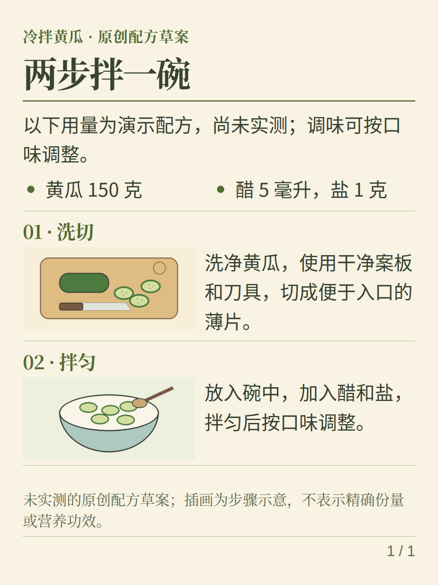](../docs/images/refinement-m2-run-40074554707/T47.png) <strong>用途：</strong>材料清单、明确用量与逐步示意图配对 <strong>图片：</strong>必需正文图片 <strong>画幅：</strong>3:4 [Markdown 示例](../examples/templates/T47.md) | **T48 生活方式产品比较**  <strong>用途：</strong>让产品图、同一组对比字段与适用限制逐件对应 <strong>图片：</strong>必需正文图片 <strong>画幅：</strong>3:4 [Markdown 示例](../examples/templates/T48.md) |

查看这组模板的内容结构与使用限制

**T45 植物留白笔记**

- 结构：元数据 image 为保全的植物插画；一个 H1；导语与一个 H2 观察记录。
- 不适合：密集数据、植物鉴定或医疗建议；这是笔记版式，不是科学鉴定工具。

**T46 暖色材料质感指南**

- 结构：元数据 image 为材质场景；一个 H1；两个 H2 分别说明触感与养护边界。
- 不适合：性能测评或未经证实的功效比较；保留产品真实资料。

**T47 料理步骤图文**

- 结构：一个 H1；导语明确食谱是否实测；材料用无序列表写真实用量或注明未提供；两个 H2 写作者提供的步骤编号，每节一个 Markdown 步骤图与一段操作。
- 不适合：漏量却要求精确配方、缺少步骤图、需要安全温度却未给出，或图文不一致；不得为美观补造数量。

**T48 生活方式产品比较**

- 结构：一个 H1；导语交代资料性质；前两个 H2 为产品，组成等权双列；每节在完整本地 Markdown 图片后列出相同顺序的两项字段；后续 H2 写全宽共同限制。
- 不适合：未经验证的价格、功效、评分、材质或实时推荐；示例对象虚构无品牌，不推断真实产品规格。

## 可选构图与维护

T20 产品截图与 T37 摄影封面有[独立构图示例](GALLERY_VISUAL_VARIANTS.md)，不是额外模板。T37 的黑色品牌历史失败图不用于此目录；当前默认文字策略见[可读性修复](T37_DEFAULT_CONTRAST.md)。

本文件由 `node scripts/build-template-catalog.mjs` 生成；更新后用 `--check` 校验。名称、用途、条件、画幅来自唯一模板注册表，PNG 来自既有图库证据校验，不重新渲染或生成新验收声明。详细历史与验证入口见[文档导航](DOCUMENTATION.md)。
