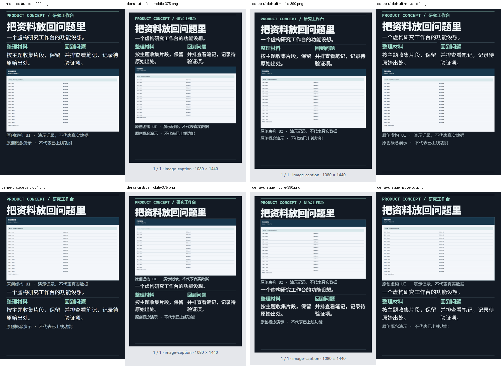
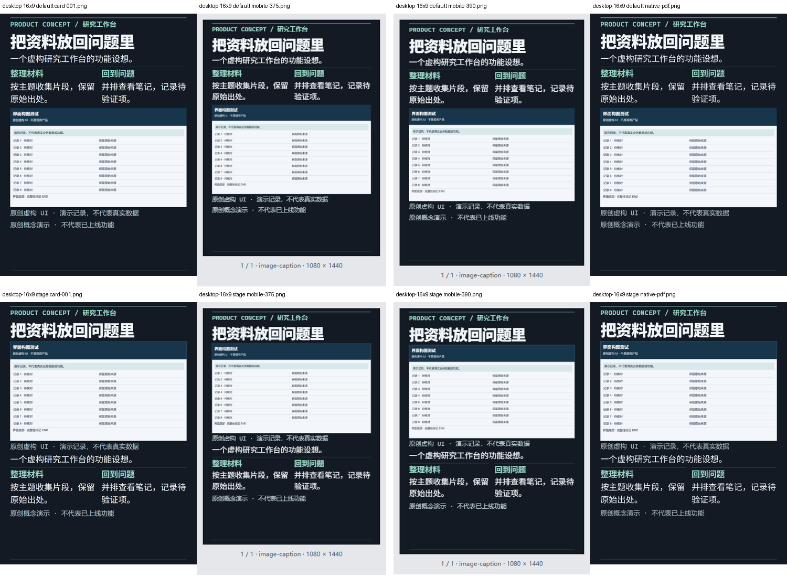
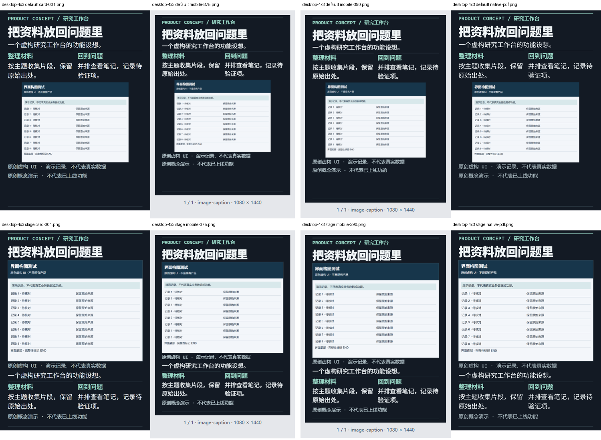
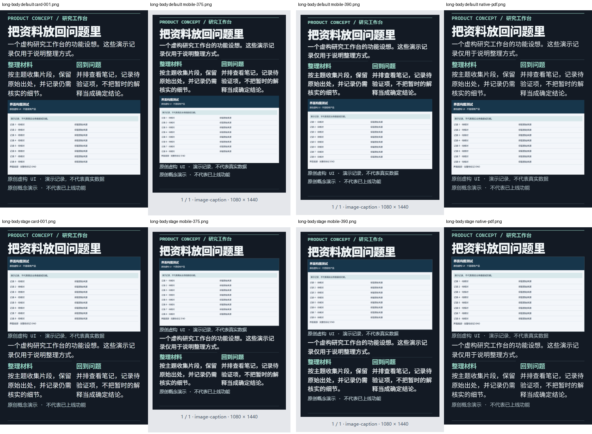
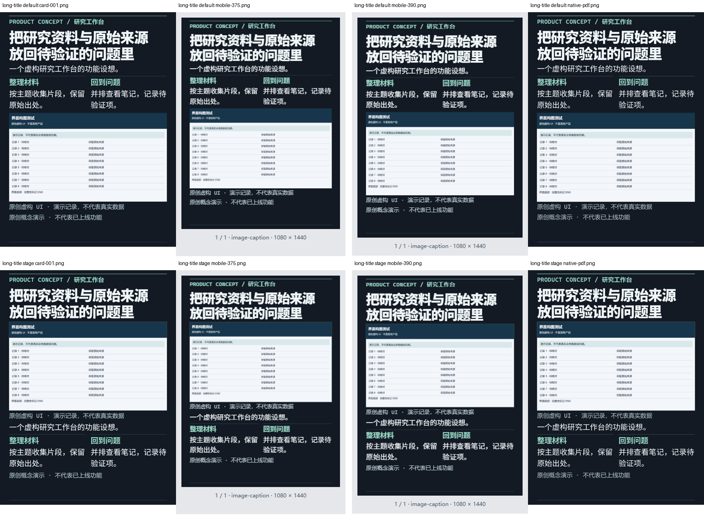
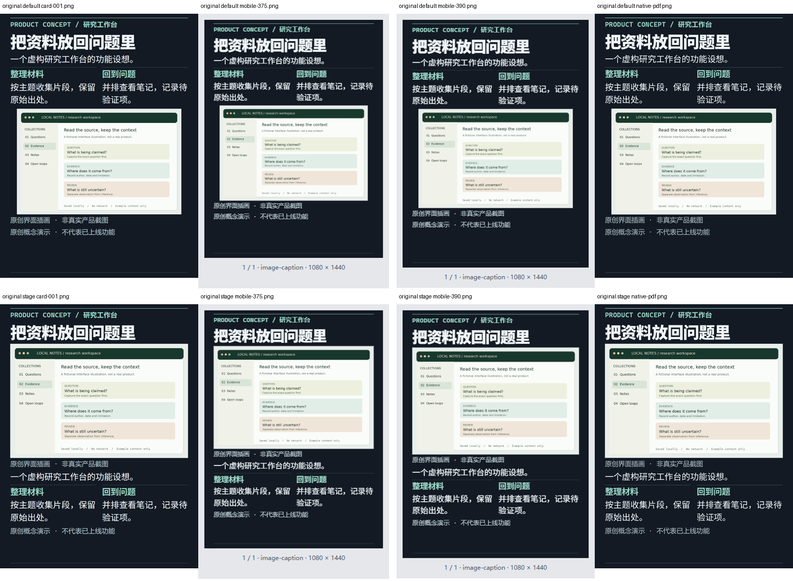
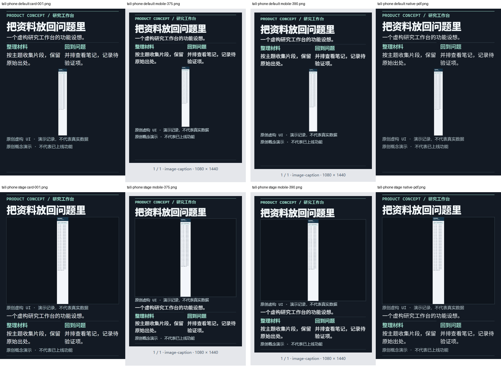

# T20 新旧对照

每组上排为默认模式，下排为 screenshot-stage；四列分别为全卡 PNG、375px、390px、原生 PDF 栅格。完整原文件在独立证据包中。长截图与高密度 UI 不承诺手机微字可读。

## dense-ui

## desktop-16x9

## desktop-4x3

## long-body

## long-source

## long-title

## original

## tall-phone

