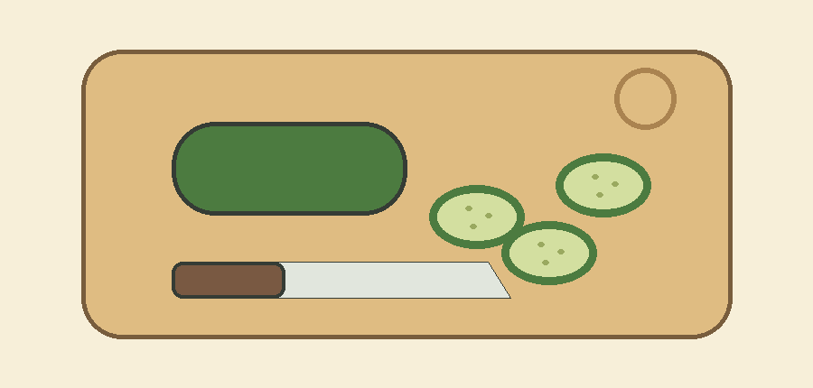
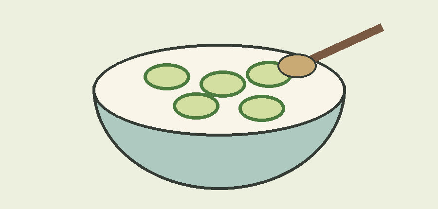

<!-- card: {"template":"T47","eyebrow":"冷拌黄瓜 · 原创配方草案","source":"未实测的原创配方草案；插画为步骤示意，不表示精确份量或营养功效。"} -->
# 两步拌一碗

以下用量为演示配方，尚未实测；调味可按口味调整。

- 黄瓜 150 克
- 醋 5 毫升，盐 1 克

## 01 · 洗切

洗净黄瓜，使用干净案板和刀具，切成便于入口的薄片。

## 02 · 拌匀

放入碗中，加入醋和盐，拌匀后按口味调整。
