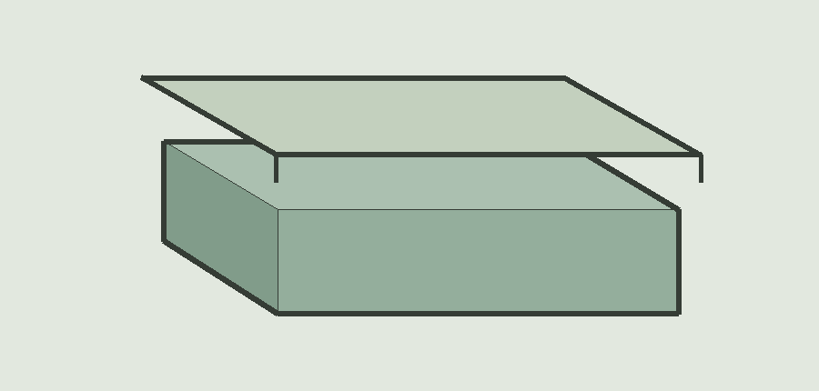

<!-- card: {"template":"T48","eyebrow":"桌面收纳 · 虚构对象比较","source":"原创无品牌物件插画；字段只描述示意结构，无价格、功效、评分或实时推荐。"} -->
# 开口托盘，还是带盖盒

两件物品均为虚构设计。这里只比较图中可见结构，不推断真实规格。

## 甲 · 开口托盘

- 开口：顶部敞开。
- 拿取：没有开盖步骤。

## 乙 · 带盖收纳盒

- 开口：配有独立盒盖。
- 拿取：盖合时需先开盖。

## 比较的边界

尺寸、材质和承重均未提供。实物是否适合，需另查真实资料。
